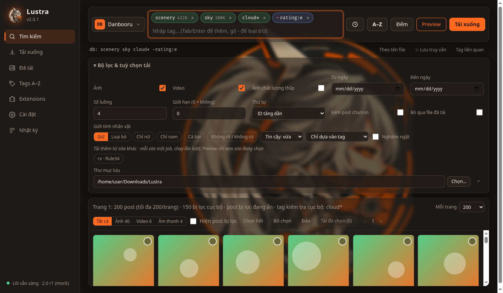
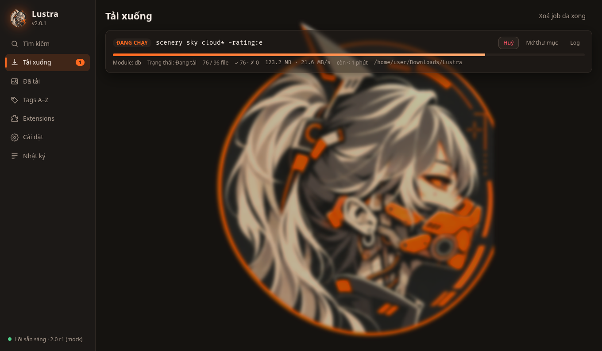
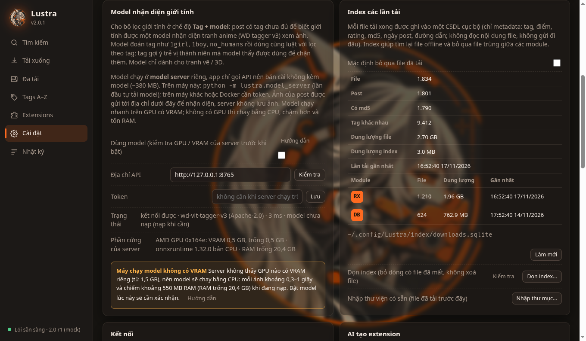

<p align="center">
  
</p>

# Lynxx

Lynxx is a booru downloader with precise tag search, a desktop app and site support delivered as extensions.
You type a query once (tags, exclusions, wildcards, OR groups, meta tags), preview what it finds, filter locally what the
site cannot, and download in the background, at the pace each site allows.

<p align="center">
  
</p>

- **Search**: tag chips with post counts and alias hints, offline autocomplete and an A–Z tag browser, "did you mean"
  for typos, related tags, counting, preview of images, videos and audio, download of the posts you pick. Search
  kinds are typed as tags (`user:Some.Name`, `favorited_by:1`, `pool:5`, and the listings an extension declares, such as
  `artist:name`) or added from the A–Z browser, which filters by tag type (artist, character, series).
  The query language is in [docs/tag-syntax.md](docs/tag-syntax.md).
- **Downloads**: a background queue with progress, speed and time left; saved queries that download new posts on a
  schedule; one query on several sites at once, with files already downloaded from another site skipped.
- **Local index**: every finished file is recorded (tags, score, rating, md5, path), so the **Downloaded** page searches
  your library offline; import a library you downloaded before, clean rows whose files are gone.
- **Character gender filter**: keep or exclude `only_female`, `only_male`, `both`, `none` from tags; optionally an image
  model for posts whose tags are not enough (see [Gender model server](#gender-model-server)).
- **Safety blacklist** (its own filter, off by default): drops posts whose tags suggest minors, in previews and downloads.
- **Extensions**: Rule34 (`rx`) and Danbooru (`db`) are built in; e621, Xbooru, Rule34.us, Rule34 Paheal,
  Rule34 Hentai, Bbooru, Gelbooru (your own API key), TBIB, Hypnohub, Safebooru, yande.re, Sakugabooru, Realbooru,
  Rule34.xyz, Rule34.world and Zerochan are optional extensions; the new ones ship their tag list and their own tag
  update; Rule34 Paheal's own update refreshes the most used tags of the list it ships. **Create an extension for a
  new site** from its address, with or without Claude: the result is always a draft you review, never installed on its
  own.
- Proxies (http, https, socks5), per-site headers and cookies, encrypted API keys, 4 themes and 4 icons.
- **Rule34 needs your own API key** (rule34.xxx: My Account > Options > API Access Credentials), entered in Settings >
  API key theo module as `KEY,USER_ID`. Lynxx ships no shared key.
- Tag lists for autocompletion, one per site, updated on demand, when the app opens, or on a system schedule (crontab /
  Task Scheduler) that runs while the app is closed.

Lynxx is based on the original work of [trickerer01](https://github.com/trickerer01) (MIT License). Full documentation, in
Vietnamese: [docs/README.md](docs/README.md) (specifications, components, operations, plans) and the development log
[docs/dev_log.md](docs/dev_log.md).

## Download

Download the installer for your platform from the
**[latest release](https://github.com/Leiz-Workspace/Lynxx/releases/latest)** (built from the `production` branch).
File names carry the version:

| Platform | File |
|---|---|
| Windows 10/11 x64 | `lynxx-setup-x64_v<version>.exe` |
| Windows 11 on ARM | `lynxx-setup-arm64_v<version>.exe` |
| Debian / Ubuntu x64 | `lynxx-linux-amd64_v<version>.deb` |
| Debian / Ubuntu arm64 | `lynxx-linux-arm64_v<version>.deb` |
| Other Linux x64 / arm64 | `lynxx-linux-x86_64_v<version>.AppImage` / `lynxx-linux-arm64_v<version>.AppImage` |
| macOS, Apple Silicon | `lynxx-mac-arm64_v<version>.dmg` (or `.zip`) |
| macOS, Intel | `lynxx-mac-x64_v<version>.dmg` (or `.zip`) |
| Checksums | `SHA256SUMS.txt` (and `build-info.json`: the commit and CI run that built the files) |

Every platform is built natively in CI (the Python core is a PyInstaller build, it cannot be cross-built) and the
packaged app runs its own self-test there before anything is published.

Install on Debian or Ubuntu:

```bash
sudo apt install ./lynxx-linux-amd64_v<version>.deb
```

Notes:

- The installers are not code-signed yet. Windows SmartScreen shows a warning: choose **More info → Run anyway**. On
  macOS, right-click the app and choose **Open** the first time.
- On Ubuntu 24.04+ the `.deb` installs an AppArmor profile for Electron's sandbox. The AppImage has none: if it does
  not start, run it with `--no-sandbox` or prefer the `.deb`.
- The command is `lynxx` on Linux and `Lynxx.exe` on Windows. Settings, tag lists, the download index and extensions
  live in `~/.config/Lynxx` (Linux), `%APPDATA%\Lynxx` (Windows) or `~/Library/Application Support/Lynxx` (macOS).
- Pre-releases from `staging` and older versions are on the
  [Releases](https://github.com/Leiz-Workspace/Lynxx/releases) page.

<p align="center">
  
  
</p>

## Gender model server

The image model of the gender filter (WD ViT Tagger v3, SmilingWolf, Apache-2.0, ~380 MB) runs in a separate model
server, so the app stays small: it only sends a post's picture and gets predicted tags back. The server keeps no
picture and never learns the query or the site. Turn it on in **Settings → Model nhận diện giới tính**: the app checks
the server's GPU and VRAM first and warns, with a guide, when the model would run on the CPU.

- **Standalone server** (no Python needed): `lynxx-model-server-<os>-<arch>-cpu_v<version>` on the release page
  (Linux x64 / arm64, Windows x64, macOS Apple Silicon; Windows also has a `directml` build for any DirectX 12 GPU).
  Unpack it and run `lynxx-model-server`; each archive has a script to start it at login (systemd, launchd or a
  Windows scheduled task). It downloads the model on the first start (pinned revision, sha256 checked).
- **Docker** (CPU, amd64 and arm64). Listening outside the container needs a token, which you then enter in the app:

  ```bash
  docker run -d --name lynxx-model -e LYNXX_GENDER_MODEL_TOKEN=<token> -p 127.0.0.1:8765:8765 \
    -v lynxx-model:/models ghcr.io/leiz-workspace/lynxx-model-server:latest
  ```

- **NVIDIA GPU**: run the server from a Python environment with `onnxruntime-gpu[cuda,cudnn]` (about 20 ms per picture
  instead of ~350 ms on the CPU), or build the image with
  `--build-arg ORT_PACKAGE='onnxruntime-gpu[cuda,cudnn]'` and run it with `--gpus all`
  ([tools/model_server/Dockerfile](tools/model_server/Dockerfile)). The GPU image is not published: the NVIDIA libraries
  have their own license terms.

The model is loaded on the first picture and its memory (RAM and VRAM) is freed after 15 minutes unused or when you
turn it off in the app. Details: [docs/operations.md](docs/operations.md) §3c.

## Command line

The Python package is also a command line downloader:

```bash
python -m lynxx -module db -path ~/Downloads/Lynxx -- scenery sky -rating:e
python -m lynxx --help
```

The desktop app bundles the same core: `<install folder>/resources/core/lynxx-core cli <arguments>`. The legacy Tk GUI
of the original code still opens with `python -m lynxx` and no arguments ([docs/legacy-gui.md](docs/legacy-gui.md)).

Lynxx is not a scraping tool: it keeps each site's request rate, stops on a bot challenge page instead of trying to
pass it, and leaves CAPTCHAs, paywalls and DRM alone.

## Develop

Requirements: Python 3.11 or newer (the frozen core is built with 3.13), Node.js 24, git.

```bash
uv venv .venv --python 3.13 && uv pip install --python .venv/bin/python -r requirements.txt
cd app && npm install && node node_modules/electron/install.js && npm start
```

Tests, lint and builds:

```bash
LYNXX_DATA_DIR=$(mktemp -d) .venv/bin/python -m unittest discover -s lynxx/tests -t .
.venv/bin/ruff check lynxx tools extensions && (cd app && npm run check)
python tools/build_core.py && (cd app && npm run dist)      # frozen core, then the app for this platform
python tools/build_model_server.py                          # standalone model server
```

The exact test list CI runs, the Electron self-test (`LYNXX_SELFTEST_DIR`) and every build option are in
[docs/operations.md](docs/operations.md).

### Layout

| Path | Contents |
|---|---|
| `lynxx/` | Python core: downloaders, tag search and filters, the sidecar the app talks to (`server.py`), download index, gender filter, model server, extension generator (`extgen/`, `aigen/`), `sdk.py` for extension authors |
| `app/` | Electron app: `main.js` (settings, secrets, jobs, IPC), `preload.js`, `renderer/` (UI), `mock.js` (UI in a plain browser) |
| `extensions/` | Optional site extensions and the local catalog; the signed remote catalog is built from it (`tools/build_catalog.py`, the `catalog` release) |
| `tools/` | Builds (core, model server), tag list cron, model server packaging (Docker, systemd, launchd, Windows) |
| `docs/` | Documentation (Vietnamese), plans, reports, release notes |
| `keys/` | Public keys of the Forgejo release signatures (minisign for the checksum file, cosign for the image) |

## Branches and releases

| Branch | Purpose | Automation |
|---|---|---|
| `develop` | Integration; open pull requests against `develop` | Tests (Linux, Windows, macOS; Python 3.11–3.15); pull requests also build and self-test the Linux app |
| `staging` | Pre-release; promoted from `develop` by pull request | Builds every platform, the model server bundles and the Docker image, and publishes the pre-release `v<version>-rc.<run>` with `SHA256SUMS.txt` and `build-info.json` |
| `production` (default) | Production; promoted from `staging` by pull request | Publishes `v<version>` as the latest release from the newest release candidate whose `build-info.json` matches the commit's tree (checksums verified, nothing rebuilt), and tags the image `<version>` and `latest`; builds again only when no candidate matches |

Pull requests into `develop`, `staging` and `production` can merge only when CI passes: a repository ruleset requires
the checks `Tests passed` and `Package (linux)`. Open the promotion pull requests from temporary branches
(`release/promote-staging`, `release/promote-production`), never from `develop` or `staging` themselves.

The organization's self-hosted Forgejo mirrors this repository. For every release tag it builds the Linux x64 files
again (`.deb`, `.AppImage`, standalone model server) and the model server image, and publishes them to its own
registries with a minisign signature on the checksum file and a cosign signature on the image.
The public keys are in `keys/`: check the Linux files with `minisign -Vm SHA256SUMS-linux -p keys/minisign.pub`
and then `sha256sum -c SHA256SUMS-linux`, the image with `cosign verify --key keys/cosign.pub <image>`.

Bump `version` in `app/package.json` and `pyproject.toml` (the workflow checks they agree) before promoting to
`staging`: a released version cannot get a new candidate. Once a version is released, a push that changes only
`docs/`, `.github/`, `.forgejo/`, `.claude/`, `lynxx/tests/`, `.gitignore` or top-level `.md` files publishes nothing, so documentation can be
promoted without a new version. Release notes come from `docs/releases/v<version>.md`.

## License

MIT, see [LICENSE](LICENSE): original work by trickerer01, derivative work Lynxx. Bundled components and the
model downloaded at run time: [THIRD_PARTY_NOTICES.md](THIRD_PARTY_NOTICES.md).

Lynxx is built on top of trickerer01's original work. Consider supporting its author:
- Boosty: https://boosty.to/bad3dart/donate
- USDT (TRC20): TVx8ufSm7DeoEnGPDiJu3aVb2sgqMfZuD7
