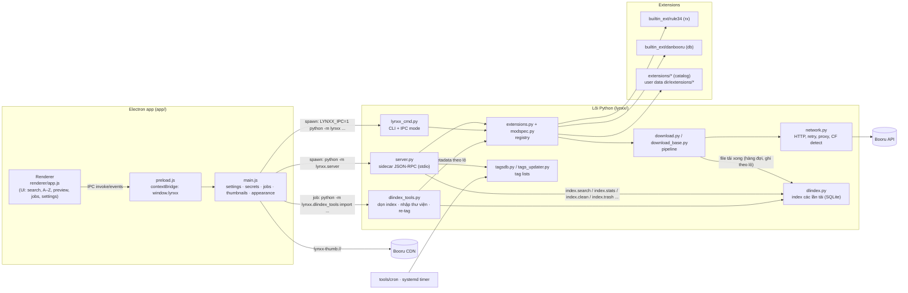

# Lynxx — Components (kiến trúc & thành phần)

> Phiên bản tài liệu: 2.0 r1 · Cập nhật: 2026-11-16 · Liên quan: [specs](specs.md), [user stories](user-stories.md), [use cases](use-cases.md), [acceptance criteria](acceptance-criteria.md), [dev log](dev_log.md)

Lynxx là bản phái sinh từ mã nguồn gốc của **trickerer01** (MIT). Lõi tải xuống bằng Python được giữ lại và tái cấu trúc thành **registry extension**. Giao diện mới dùng **Electron**, nói chuyện với lõi qua **sidecar JSON-RPC**. Mỗi lượt tải chạy trong **một tiến trình CLI riêng**.

## 1. Sơ đồ tổng thể



## 2. Thành phần Python (`lynxx/`)

| Thành phần | File | Trách nhiệm |
|---|---|---|
| Entry | `__main__.py`, `lynxx.py` | Có tham số → CLI, không có → GUI Tk cũ (legacy) |
| CLI | `lynxx_cmd.py`, `cmdargs.py` | Parse tham số (argparse), chọn module, chạy downloader. Khi `LYNXX_IPC=1`: in dòng `@@LYNXX_PROGRESS {json}` mỗi 0,4 s, nhận lệnh `cancel` qua stdin |
| Sidecar | `server.py` | JSON-RPC 2.0 trên stdio cho UI: tags, preview, count, extension, cập nhật tag, index các lần tải (`index.search`, `index.stats`; mỗi lời gọi một kết nối SQLite riêng; `index.clean` chạy ở thread nền, báo bằng notification `index.cleanProgress` / `index.cleanDone`, mỗi lúc một lượt, `index.cleanCancel`; thùng rác: `index.trash {paths, roots}`, `index.restore`, `index.purgeTrash {days \| paths \| all}`, `index.forget`, `index.search {trash: true}`; tối đa 1000 đường dẫn tuyệt đối mỗi lời gọi). Chuyển toàn bộ `print` sang stderr để giữ kênh giao thức sạch |
| Registry module | `module.py` | `ProcModule`: id ổn định cho module mà lõi biết sẵn (rx=1 … bb=7, db=8); extension mới nhận id từ 100 trở lên (`register()`) |
| Registry extension | `extensions.py`, `modspec.py` | Đọc `manifest.json`, kiểm tra schema, import class downloader (`importlib`), đăng ký cú pháp tag, giới hạn tag, tiền tố file, kiểu tìm (`search`, cho mọi module kể cả module lõi đã biết; từ 2.0.11, `MANIFEST_KEYS_SINCE`). Cài từ catalog, thư mục, zip (bắt buộc sha256, chống zip-slip) hoặc URL; gỡ cài đặt. Kiểm `minSdkVersion` với `lynxx.sdk` khi cài và khi nạp; từ chối extension cho site trong danh sách chặn tên miền (manifest `site` / `homepage`, URL trong code / json) ở mọi đường cài và lúc nạp. Catalog từ xa: tải `index.json` + `.sig`, kiểm chữ ký (`trust.py`) trước khi đọc mục, đánh dấu `signed` / `keyId` / `denied`; `install_from_remote_catalog` kiểm lại catalog, sha256 người dùng đã xác nhận và id trong archive |
| SDK cho extension | `sdk.py` | `lynxx.sdk`, API ổn định cho `downloader.py` (`SDK_VERSION` 1.2): các lớp nền downloader, `JsonPost`, kiểu item / media, hằng số, regex item chung, helper mạng được phép, `trace`, `TagJob` (1.1: job cập nhật tag của extension, manifest `tagUpdate`), `split_kind` + `KindMatch`, `current_kind`, hook `_items_per_page` / `_max_pages`, `robots_allows` / `require_robots_allowed` (1.2: kiểu tìm, manifest `search`); `sdk_satisfies` cho `minSdkVersion`. Template của trình tạo và AI import từ đây; extension cũ vẫn import module lõi |
| Danh sách chặn tên miền | `denylist.py`, `safety_data/denied_domains.txt` | Rule R6 / R7 / R8: mục chặn tên miền và mọi tên miền con, có thể ghi dạng `sha256:`. So host ở mọi dạng (chữ thường, bỏ dấu chấm cuối, `%xx`, punycode qua IDNA 2008 / UTS 46 và IDNA 2003). `denied_in_extension` quét manifest và URL trong file `.py` / `.json` của một extension. File thiếu hoặc hỏng → lỗi, không bao giờ coi như danh sách rỗng |
| Catalog có chữ ký | `trust.py`, `ed25519.py`, `safety_data/catalog_keys.json` | Ed25519 Python thuần (RFC 8032, có test vector). Chữ ký tách rời `<index>.sig` (`lynxx-catalog-sig/1`, ký trên `lynxx-catalog-v1\n` + byte của index), khoá tin cậy đi kèm Lynxx (đang là danh sách rỗng giữ chỗ), `expires` tuỳ chọn. Biến môi trường cho nhà phát triển: `LYNXX_CATALOG_KEYS_FILE`, `LYNXX_CATALOG_ALLOW_UNSIGNED=1` (chữ ký sai vẫn bị từ chối) |
| Factory | `downloaders.py` | `DOWNLOADERS_BY_PROC_MODULE` do registry điền; `_make_downloader()` tự nạp catalog cho CLI/GUI cũ |
| Pipeline | `download.py`, `download_base.py` | Parse tag → chia task → đếm → tìm trang biên (binary search theo ngày/ID) → quét trang → chuỗi bộ lọc → tải → ghi info JSON. Truy vấn 1 task dùng **streaming**: quét theo thứ tự tải, lọc từng lô, tải ngay, `-dlimit` dừng quét sớm; Danbooru quét bằng cursor id. 3 executor bền (`scan`, `info`, `dl`) có hàng chờ giới hạn và huỷ tức thì. Hook và `CAPABILITIES` thay cho các kiểm tra tên module viết cứng |
| Công cụ index | `dlindex_tools.py`, `file_identify.py` | CLI `python -m lynxx.dlindex_tools clean / import / retag / trash` (lõi đóng băng: `lynxx-core index …`). **trash**: `list` (mới xoá trước), `purge --days N \| --all` (`DownloadIndex.purge_trash`). **clean**: `clean_index` → `DownloadIndex.clean_missing` (dòng có file đã mất; giữ dòng có cả thư mục đã mất trừ khi được yêu cầu; theo lô 500 dòng, mỗi lô một transaction ngắn). **import** (`LibraryImport`): quét thư mục (`scan_library`: đuôi media, bỏ file rỗng / `.part` / thư mục ẩn / symlink thư mục), bỏ file đã có trong index theo đường dẫn, nhận module + id / md5 từ tên file bằng luật của `files.identify` (`file_identify.identify_file_name`), lấy metadata qua downloader của module (Danbooru danh sách `id:a,b,…` / `md5:…` 100 mục một request; module khác một request mỗi post), giãn cách ≥ 0,5 s hoặc theo `_get_min_request_interval`, ghi bằng `record_for` (thời điểm tải = mtime của file). Tên không nhận ra, post không có trên site, request lỗi, md5 khác (tuỳ chọn `--verify-md5`) được đếm và liệt kê. Chế độ job (`LYNXX_IPC=1`): dòng `@@LYNXX_PROGRESS`, `cancel` qua stdin, khoá API theo module qua `LYNXX_SECRET_MODULE_ARGS`. **retag**: công cụ re-tag với tag từ index (`file_tagger.item_infos_from_index`), file info JSON làm dự phòng |
| Index các lần tải | `dlindex.py` | SQLite `<data>/index/downloads.sqlite` (WAL, `busy_timeout` 10 s, schema theo `PRAGMA user_version`). Bảng `files` (một dòng mỗi file, khoá duy nhất là đường dẫn; index theo `(module, post_id)`, `md5`, ngày post, thời điểm tải), `tag_names` + `file_tags` (tìm tag chính xác hoặc theo tiền tố bằng index). `IndexWriter`: `Downloader._download` chỉ đẩy bản ghi vào hàng đợi, thread `dlindex` ghi theo lô; đóng (flush) ở cuối `_launch`, kể cả khi huỷ hoặc lỗi. `DownloadIndex.find_known` cho `-skip_known` (bộ lọc `_filter_known_items_by_id` trước khi lấy info, `_filter_known_items_by_md5` sau khi lấy info); `search` / `stats` cho sidecar. Bảo trì: `clean_missing` (xoá dòng kèm `file_tags` theo `id + path + downloaded_at`, nên dòng vừa được job khác ghi lại không bị xoá; không xoá `tag_names` vì writer giữ cache id), `known_paths`, `rows_for_paths` / `rows_for_posts`, `rename_paths` + `rename_indexed_files` (công cụ re-tag / un-tag / sắp xếp đổi tên hay chuyển file thì dòng đi theo). Chỉ metadata, không đọc file; tắt ghi bằng `LYNXX_DLINDEX=0`. Schema 3 (`MIGRATIONS`: schema cũ được nâng cấp bằng `ALTER TABLE`, dòng cũ giữ nguyên): cột `trashed_at`, `orig_path`, `moving_to`, index một phần `files_trashed_at`, `files_moving_to`. Thùng rác: `trash` (chỉ dòng có trong index, file còn trên đĩa, chưa ở thùng rác; chỉ `os.replace` vào thư mục của `trash_folders`: `<data>/trash` cùng ổ → `.lynxx-trash` ở gốc thư mục tải → `.lynxx-trash` cạnh file, EXDEV thì thử chỗ sau; tên `<id>_<tên>`), `restore` (về `orig_path`, tạo lại thư mục, tên đã dùng thì `_1`, `_2`); cả hai theo lô 200 file, hai bước: `_plan_moves` ghi chỗ đến vào `moving_to`, `_move_planned` đổi tên và cập nhật dòng trong một giao dịch giữ khoá ghi (lỗi thì đổi tên lại trước khi rollback); `recover_moves` hoàn tất hoặc bỏ lượt chuyển dở do tiến trình bị dừng (gọi đầu `trash` / `restore` / `purge_trash` / `forget` / `clean_missing` và ở `index.search` / `index.stats`). `purge_trash` (theo tuổi / đường dẫn / tất cả; xoá file chỉ trong thư mục thùng rác rồi xoá dòng + `file_tags` theo lô; giữ dòng khi thư mục thùng rác không truy cập được, bỏ qua dòng đang chuyển), `forget` (dòng có file đã mất; không bỏ dòng thùng rác có thư mục không truy cập được). `find_known`, `search`, `stats` (kèm khối `trash`), `rows_for_posts`, `posts_after` bỏ qua dòng trong thùng rác |
| Mạng | `network.py` | `requests.Session` riêng cho mỗi thread (API và tải file, giữ keep-alive). Retry có giới hạn, `Retry-After` với backoff dùng chung cho mọi thread, dừng ngay khi gặp `cf-mitigated: challenge`, giãn cách request theo module. Tải file: 1 GET stream vào `.part`, không HEAD, resume bằng Range/If-Range, lỗi vĩnh viễn không retry; HTML/XML chỉ parse khi cần; tuỳ chọn tải không qua proxy |
| Cú pháp tag | `tags_parser.py`, `task.py`, `search_kinds.py`, `rex*.py` | Kiểm tra cú pháp; tách nhóm OR thành nhiều task; nhóm loại trừ `-(a,b)` thành regex; khi vượt giới hạn tag thì đẩy phần dư sang lọc cục bộ (cả tag phủ định lẫn tag dương, với module cho phép). Kiểu tìm của từng module (`search_kinds.py`, manifest `search`): tag của kiểu được kiểm theo regex của kiểu; token và `metaNames` là metatag của module (không bao giờ chuyển sang lọc cục bộ); kiểu listing không tính vào giới hạn tag, đẩy mọi tag thường sang lọc cục bộ, theo thứ tự của site |
| Tag DB | `tagsdb.py` | Nạp `<abbr>_tags.json` theo kiểu lazy vào cấu trúc gọn (khối bytes tên + mảng số), cache nhị phân ở `<data>/cache/tags/`, tối đa 2 danh sách trong RAM (LRU), lock riêng (thread-safe). Autocomplete xếp theo số post; duyệt A–Z (`browse`) bằng tìm nhị phân, kết quả sắp theo số post được cache |
| Cập nhật tag | `tags_updater.py`, `robots.py`, `tags_learned.py`, `extgen/taglist.py`, `tools/update_tags.py` | Tải danh sách tag từ API: Rule34/Gelbooru phân trang theo số trang `pid` (danh sách tag của site không theo thứ tự id, con trỏ `after_id` bỏ sót tag), Danbooru dùng `page=a<id>`, e621 dùng file export hằng ngày; extension tạo từ trình tạo lấy nguồn theo `$generator.engine` + `site` của manifest (thêm Moebooru, Philomena, Szurubooru, Shimmie). Mọi request qua `PoliteClient`: robots.txt RFC 9309 (`robots.py`, nghiêm ngặt với extension, 5 module đã duyệt là ngoại lệ), `Crawl-delay`, `Retry-After`, ngân sách request, không cookie, dừng khi gặp bot challenge. Ghi file atomic, có kiểm tra sanity. Extension mới có danh sách ngay: `extgen/taglist.py` kèm danh sách của site vào bản nháp (TagsDB đọc nó trong thư mục extension đã cài); site không có API danh sách tag thì `tags_learned.py` học từ post đã xem (Preview) và đã tải (index), không gửi request; với danh sách đi kèm extension không có nguồn (rn, rs) hoặc có job gộp (rp từ 1.0.3) nó chỉ ghi các tag danh sách đó chưa có, `tagsdb.py` ghép chúng vào danh sách khi nạp; job gộp (`tagUpdate.merge`) chỉ cập nhật các tag nó đọc được, `tags_updater.py` gộp chúng vào danh sách đang dùng |
| Module tích hợp sẵn | `download_rx.py` (+`download_gelbooru.py`), `download_db.py` | Rule34 (DAPI XML) và Danbooru (JSON API) |
| Lớp nền JSON API | `download_json.py` | `DownloaderJsonApi` + `JsonPost`. Lớp con chỉ khai báo site, URL tìm kiếm, cách đọc một post, và (tuỳ chọn) cách đếm, URL con trỏ id; override `_parse` để đọc XML (Shimmie) hoặc HTML (BeautifulSoup); `JsonPost.ext` cho URL file không có đuôi. Phân loại ảnh / video / âm thanh theo đuôi file, âm thanh vào `-audsub` và không dùng làm ảnh xem trước. Lớp nền lo phần còn lại: đếm (từ trang, endpoint riêng hoặc tìm nhị phân trang cuối), chuỗi item cho lõi, URL tương đối, ngày ISO / unix, post không có file (bỏ qua, không dựng URL), quét theo con trỏ id khi vượt độ sâu trang. Template e621 / Moebooru / Philomena / Szurubooru và extension do AI viết dùng lớp này |
| Lọc giới tính (tầng 0) | `gender.py`, `gender_rules/{db,rx,bb,en,gelbooru_generic}.json` | Suy nhãn `only_female/only_male/both/none/unknown` + độ tin cậy + cờ (futa, trap, other, anthro, pov, real) từ tag; `decide()` theo ngưỡng và chế độ strict. Bộ lọc `_filter_items_by_gender` chạy cuối chuỗi, không áp cho task parent |
| Lọc giới tính (tầng 1, model ảnh) | `gender_model.py` | `-gender_mode model`: post có tag chưa đủ kết luận được WD tagger v3 xem ảnh (`sample_url` hoặc thumbnail, tải bằng `wrap_request` của downloader, 3 ảnh song song). `backend()` chọn nơi chạy model: `ModelApi` (client HTTP của model server: `check_api_url` chỉ cho http trong máy / mạng nội bộ, không theo redirect, không qua proxy hệ thống khi gọi loopback, chỉ thử lại khi 503 `busy`; `load` / `unload`) hoặc `GenderTagger` (ONNX trong tiến trình, chỉ khi không có địa chỉ; GPU nếu onnxruntime có provider GPU, `device` cho biết chạy ở đâu; ảnh hỏng → `BadImage`). Tag đoán ra (≥ 0,35) đi qua bộ luật `db` (`classify`), gộp với nhãn từ tag bằng `combine`; tag cấm ≥ 0,15 là safety gate. Kết quả cache SQLite `cache/gender_model.sqlite` theo post + id model + bộ luật `db` (`verdict_cache_model`: đổi luật thì xem lại). Tải / kiểm sha256 / xoá model, CLI `python -m lynxx.gender_model`. Dùng ở `_filter_items_by_gender` (tải) và `_apply_gender_model` của `search.preview` (≤ 40 post / trang); RPC `gender.modelStatus`, `gender.modelLoad`, `gender.modelUnload` (`api_status` kèm `check` phần cứng). `-gender_verify_media`: `predict_frames` (`ModelApi`: gửi file tới `/v1/frames`, thử lại khi 503 `busy` bằng cách mở lại file; `GenderTagger`: đọc khung trong tiến trình), `classify_frames` (gộp theo tag: có mặt ≥ 2 khung, vắng khi mọi khung ≤ 0,2, nhãn chỉ giữ khi mọi tổ hợp tag chưa rõ đồng ý; safety gate trên từng khung), `media_support` (server có bộ giải mã nào), `verdict_for_media`; `MediaUnreadable` = chỉ file đó không xem lại được |
| Release | `.github/workflows/release.yml`, `tools/check_selftest.py`, `docs/releases/` | Build mọi nền tảng (Linux / Windows x64 + arm64, macOS arm64 + Intel), model server chạy độc lập, image Docker trên ghcr; rc từ `staging`, release từ `production` (dùng lại file của rc); `check_selftest.py` đọc báo cáo self-test của bản đóng gói |
| Phát hành trên Forgejo | `.forgejo/workflows/ci.yml`, `.forgejo/workflows/forgejo-release.yml` | Chạy trên Forgejo của Home Server (pull mirror `mirror/Lynxx`, runner `docker`): CI lint và test với mỗi push lên ba nhánh; với mỗi tag `v*` build lại bản Linux x64 (`.deb`, `.AppImage`, model server chạy độc lập) kèm self-test, ký `SHA256SUMS-linux` bằng minisign, đăng generic / Debian / Release, image model server quét Trivy và ký cosign |
| Model server chạy độc lập | `tools/build_model_server.py`, `tools/model_server/lynxx_model_server.py` | Bản PyInstaller one-dir của model server cho người dùng không có Python: môi trường build riêng (onnxruntime CPU hoặc DirectML), entry gọi `multiprocessing.freeze_support()` cho tiến trình con của model, kèm LICENSE, notices và script chạy nền; smoke test nạp model, nhận diện, giải phóng |
| Chạy nền model server | `tools/systemd/*.service`, `tools/launchd/install-model-server.sh`, `tools/windows/install-model-server.ps1` | systemd user (bản venv và bản đóng gói), LaunchAgent macOS, Scheduled Task Windows lúc đăng nhập |
| Phần cứng của model | `model_hw.py` | `detect_hardware()`: GPU và VRAM (NVIDIA: `nvidia-smi`; AMD / Intel trên Linux: `/sys/class/drm`), provider của onnxruntime, RAM, CPU (giữ 10 s). `hardware_check(hw, device, setting)`: `gpu` / `no_gpu` / `gpu_no_runtime` / `cpu_forced` / `vram_low` / `gpu_fallback` / `unknown` (VRAM tối thiểu 1,5 GB, đo được 1,26 GB), dùng cho cảnh báo trước khi app bật model. Không import numpy / onnxruntime ở cấp module (lõi đóng băng chỉ dùng `hardware_check`) |
| Model server | `model_server.py` | HTTP API (`ThreadingHTTPServer`, stdlib) quanh `GenderTagger`: `GET /v1/status` (kèm phần cứng và bộ giải mã `media`), `POST /v1/tag` (bytes ảnh → tag + xác suất), `POST /v1/frames` (video / ảnh động ≤ 200 MB → tag của tối đa 8 khung; file tạm trong thư mục 0700, xoá trước khi trả lời; 415 khi không có bộ giải mã), `POST /v1/load`, `POST /v1/unload`. Model chạy trong tiến trình con (`ModelProcess`: spawn, pipe, nhiều ảnh cùng lúc, tiến trình chết thì nạp lại một lần), nạp lười, tự giải phóng sau `--idle-unload` giây (tiến trình con thoát: trả hết RAM / VRAM), `--device auto\|cpu\|gpu`, `--preload`, socket `TCP_NODELAY`. Token Bearer (bắt buộc ngoài loopback), giới hạn 12 MB / 40 triệu pixel, số worker, 503 khi bận, 500 khi model lỗi, tự tải model lần đầu. Không kèm trong bản app; chạy bằng `python -m lynxx.model_server`, `tools/systemd/lynxx-model-server.service` hoặc Docker `tools/model_server/Dockerfile` |
| Khung của video / ảnh động | `media_frames.py` | `-gender_verify_media` (plan §3.5, P4). `file_media_kind`: video (mp4 / mov, webm / mkv, avi) hay ảnh động (GIF / APNG / WebP nhiều khung) qua các byte đầu, thuần Python (lõi đóng băng không có Pillow). `extract_frames`: tối đa 8 khung cách đều trong đoạn 5 %–95 %, ≤ 896 px; video bằng ffmpeg / ffprobe trên PATH (subprocess có giới hạn thời gian, định dạng ép bằng `-f`, `-protocol_whitelist file`) hoặc PyAV, ảnh động bằng Pillow `ImageSequence`. `decoders()` cho `/v1/status`. `MediaError(unsupported)` → 415 / 400. CLI `python -m lynxx.media_frames FILE…` |
| Đánh giá lọc giới tính (P1) | `gender_eval.py` | CLI `python -m lynxx.gender_eval`. `sample`: lấy post qua downloader của module (chỉ metadata), loại theo thứ tự §3.2 có đếm từng bước (danh sách chặn trên tag + alias, danh sách loại bổ sung, ảnh thật, trùng md5, không có file), gắn nhãn tầng 0 và slice §3.7, phân tầng → manifest JSON. `label`: trang gán nhãn cục bộ (`ThreadingHTTPServer`, chỉ `127.0.0.1`, kiểm Host + token, phím tắt), ảnh tải vào RAM qua `ImageFetcher` (một luồng, một session của downloader, chỉ URL cùng domain với site, giãn cách), safety gate của model trước khi người xem; mỗi người một file nhãn; "không an toàn" xoá post khỏi manifest và báo tag. `agree`: Cohen's κ, danh sách bất đồng, tập vàng (đồng thuận + trọng tài). `evaluate`: tầng 0 / model / tầng 0 + model với tập vàng, hoặc silver (tham chiếu = nhãn tầng 0 mức high, model chỉ nhận ảnh); precision theo lớp, độ phủ, macro-F1, ma trận nhầm lẫn, ECE, risk–coverage, slice, cờ thiên lệch → `report.json` + `report.md`; cache tag đoán ra (`predictions.jsonl`) để chạy tiếp sau khi dừng; post bị safety gate chặn bị xoá khỏi manifest như ở `label` (`drop_from_manifest`: chỉ ghi khoá và tag của gate). Không lưu ảnh |
| An toàn | `safety.py` | Danh sách chặn cứng (token + tag cụ thể). `_filter_items_safety` chỉ chạy khi bật bộ lọc giới tính, cho mọi task kể cả parent. Không có API gỡ; extension chỉ thêm |
| Tiện ích file | `file_tagger.py`, `file_sorter.py`, `file_searcher.py`, `file_parser.py` | Gỡ/gắn lại tag trên tên file (tag lấy từ index, file info JSON làm dự phòng), phân loại vào thư mục (dòng index đi theo file bị đổi tên / chuyển), tìm file trùng, đọc danh sách ID/info |
| Bộ tạo extension (công cụ) | `extgen/`: `fetch.py`, `engines.py`, `templates.py`, `policy.py`, `sandbox.py` + `sandbox_boot.py`, `scaffold.py`, `__main__.py` | `SafeFetcher`: chỉ https, IP công khai (chặn SSRF), đúng host của site, robots.txt (RFC 9309), 1 request/giây, ngân sách request, không cookie, redirect được kiểm lại, dừng khi gặp Cloudflare challenge (R5). Nhận diện engine bằng probe. Template cho 7 engine: `gelbooru_dapi`, `danbooru_json`, `e621_json`, `moebooru_json`, `philomena_json`, `szurubooru_json`, `shimmie_api`; mẫu `HTML_EXAMPLE` cho AI (trang danh sách HTML). Kiểm tra tĩnh bằng AST (allowlist import, cấm eval / file / dunder / override hook lõi, sàn interval 0,5 s). Sandbox: tiến trình con `-I`, môi trường rỗng, rlimit, audit hook chặn socket / subprocess / ctypes / ghi ngoài tmp / đọc ngoài thư viện Python, mã Lynxx, bản nháp và tmp; request của downloader đi qua tiến trình cha (`@@FETCH`, chỉ chuyển header `Accept`), file không được tải. Manifest: cấm cookie đăng nhập / challenge. Ghi fixture, chạy lại offline, đóng gói zip tất định + sha256. `record` lưu `robots.txt` của site cạnh manifest (`SafeFetcher.robots_txt`, không thêm request; `pack` đưa vào zip) cho SDK 1.2 `robots_allows`; kiểu tìm của manifest (`search`) được kiểm `search:<id>` (địa chỉ tìm dựng trong sandbox cho một giá trị mẫu phải được robots.txt đã lưu cho phép) và `search:robots` (khai báo kiểu mà không có robots.txt đã lưu). CLI cho skill |
| AI tạo extension | `aigen/`: `session.py`, `tools.py`, `prompts.py`, `template_agent.py`, `worker.py` | Vòng lặp Claude (stream, 9 tool phía client, lịch sử chỉ nối thêm) với giới hạn lượt / chi phí / số lần chạy thử, huỷ được. Sau khi model nói xong vẫn kiểm tra độc lập (`check_draft`). Chế độ `template` thay model bằng kế hoạch cố định, không cần khoá. Ghi `report.json`. Không có tool nào cài extension |
| Eval trình tạo | `aigen/eval.py`, `aigen/eval_sites.json` | `python -m lynxx.aigen.eval run / estimate`: chạy bộ site với kết quả mong đợi (trạng thái, engine, rule), đo tỉ lệ đạt, chi phí, lượt model, bước tool, request, thời gian, lỗi; ghi / phát lại fixture site (`Recorder`, `RecordingSession`, `ReplaySession`); chế độ template, model giả lập (`FakeModelClient`) và AI (cần `--confirm-cost`, dừng theo tổng trần chi phí); kiểm không cài gì và khoá API không lộ. Công cụ dev, không có trong lõi đóng băng |
| GUI cũ (Tk) | `gui.py`, `gui_base.py`, `gui_defines.py` | Giữ để tương thích; tkinter giờ là tuỳ chọn với lõi (`utils.confirm_yes_no` import lazy) |

### 2.1. Hook và capability của downloader (mới)

| Hook / thuộc tính | Mặc định | Ghi đè bởi |
|---|---|---|
| `CAPABILITIES` (`ModuleCaps`) | sources, date_filter, comments | mỗi module (rx: api_key, api_key_required, parent_child…; db: api_key, parent_child, preview…) |
| `_parses_raw_pages()` | False | en, db (JSON) |
| `_supports_native_date_filter()` | False | db (dùng metatag `date:a..b`) |
| `_get_page_fetch_delay()` | 0 | rp, en, xb, bb: 1,0 s |
| `_get_page_scan_threads_divisor()` | 2 | rp: 4 |
| `_get_min_request_interval()` | 0 | en: 0,5 s; db: 0,25 s (dùng chung cho mọi thread) |
| `_use_chunked_download()` | True | rx: chỉ với video |
| `_fix_link_after_download_error()` | giữ link | rx: chuyển sang link gốc khi 404; rs: bỏ CDN |
| `_solve_module_specific_conflicts()` | — | en: giới hạn 2 thread khi lấy bình luận |
| `extract_preview_url()` | `preview_url` → `sample_url` → `` | — |

## 3. Extension

```
lynxx/builtin_ext/rule34/manifest.json      entry: lynxx.download_rx:DownloaderRx  (default)
lynxx/builtin_ext/danbooru/manifest.json    entry: lynxx.download_db:DownloaderDb  (default)
extensions/<id>/{manifest.json, downloader.py}   catalog cục bộ: rule34hentai, rule34us, paheal, e621, xbooru, bbooru
extensions/<id>/{…, tags.py, specs.md}       kèm job riêng (tagUpdate): gelbooru, tbib, hypnohub, safebooru, yandere,
                                             sakugabooru, realbooru, rule34xyz, rule34world, zerochan; tag list
                                             <abbr>_tags.json chỉ nằm trong zip (không commit, docs/plans/ext-tag-jobs.md)
extensions/paheal/{…, tags.py}               job gộp (tagUpdate.merge, từ 1.0.3), không có specs.md: khảo sát site nằm ở
                                             docstring của tags.py; zip mang 2tags/rp_tags.json làm nền
<data dir>/extensions/<id>/                  extension người dùng đã cài
```

- Thứ tự nạp: builtin → user → (catalog, chỉ cho CLI/GUI cũ hoặc khi gọi `_make_downloader` với module chưa nạp).
- Extension ngoài chỉ được dùng entry dạng file (`downloader.py:Class`). Entry dạng module Python chỉ dành cho builtin.
- Extension mới import từ `lynxx.sdk` và khai báo `minSdkVersion`; 6 extension trong catalog `extensions/` vẫn import thẳng hằng số của lõi (`lynxx.defines`, `lynxx.rex`) và vẫn chạy.
- Site trong `lynxx/safety_data/denied_domains.txt` không bao giờ được cài hay nạp.
- Schema: [`schemas/extension-manifest.schema.json`](schemas/extension-manifest.schema.json).

## 4. Electron (`app/`)

| Thành phần | File | Trách nhiệm |
|---|---|---|
| Main | `main.js` | Vòng đời cửa sổ; dò Python (`settings.advanced.pythonPath` → `LYNXX_PYTHON` → `.venv` → `python3`); quản lý sidecar (khởi động lại theo backoff, tối đa 5 lần); `Jobs` (hàng đợi, giới hạn số job song song, huỷ qua stdin, kill sau 15 s; nhóm tải nhiều site `startMulti`: mỗi site một job, `_waiting` cho site sau chờ site trước xong, ép `-skip_known` + `-prefix`; job nhập thư viện `startImport`: lệnh lõi `index import`, thư mục chỉ nhận từ hộp thoại `index:pickFolder`); dọn index `index:clean` (hộp xác nhận native có ô "xoá cả dòng có thư mục không còn"); thùng rác của trang Đã tải: `library:trash` / `library:restore` (không hỏi, gốc thư mục tải gửi kèm), `library:forget` / `library:purge` / `library:emptyTrash` (hộp xác nhận native `confirmLibrary`), truy vấn đã lưu tự tải lại chỉ thêm `id:>N` khi module tìm được theo id và truy vấn không có kiểu listing (`autoIdSearch` / `autoIdFilter`, theo `ext.list`); tự dọn file quá `settings.library.trashDays` (mặc định 30, 0 = không; 60 s sau khi lõi sẵn sàng, rồi tối đa 12 giờ một lần trên nhịp 5 phút, và khi số ngày được giảm); settings JSON atomic; API key mã hoá bằng `safeStorage` (async); protocol `lynxx-thumb://` (cache đĩa tối đa 512 MB, gửi Referer của site); proxy cho session thumbnail; đổi icon/nền; tạo launcher `.desktop`; chế độ tự kiểm thử `LYNXX_SELFTEST_DIR`. `Generator`: chạy worker `aigen` (khoá Claude giải mã ở main rồi ghi vào stdin), chuyển event `gen:event`, liệt kê / đọc / xoá bản nháp (đường dẫn suy từ phiên + id, không lấy từ file), xuất zip, **cài chỉ khi người dùng bấm**: kiểm tra lại offline → đóng gói → hộp thoại xác nhận → `ext.install`. Khoá Claude lưu ở `secrets['@anthropic']` và chỉ ở dạng mã hoá. Cài từ catalog từ xa (`ext:installRemote`): renderer chỉ gửi id, main lấy URL + sha256 từ catalog lõi đã kiểm chữ ký, hỏi xác nhận (kèm trạng thái chữ ký) rồi gọi `ext.install {catalogUrl, remoteId, sha256}`; bản nháp bị chặn tên miền báo đúng lời nhắn của lõi |
| Lịch cập nhật tag | `tag-schedule.js` (hàm thuần, test `app/test/tag-schedule.test.js` chạy trong `npm run check`), `main.js` (`tagScheduleStatus`, `applyTagSchedule`, `refreshTagSchedule`) | Khối có đánh dấu trong crontab (Linux / macOS) hoặc tác vụ Task Scheduler (Windows) chạy `lynxx-core tags` cho db, en, xb, bb; ghi lại mỗi lần mở app; AppImage không hỗ trợ |
| Preload | `preload.js` | Chỉ expose `window.lynxx` (rpc, search, jobs, settings, secrets, gen, dialogs, appearance, app, on). `gen.setKey` chỉ ghi, không đọc lại. Renderer không thấy API key và không tự spawn tiến trình. `jobs.rerun(id, allowDuplicate)`; kênh `nav:page` (bấm thông báo); `saved.setAuto`; `library.open / reveal / trash / restore / forget / purge / emptyTrash`; `index.clean / cleanCancel / pickImportFolder / importLibrary`; `jobs.startMulti`; `mediaUrl` (`lynxx-thumb://m/`) |
| Renderer | `renderer/index.html`, `styles.css`, `app.js` | Ô nhập tag dạng chip + autocomplete; kiểu tìm (kiểu khai báo từ `ext.list` `search`, gõ bằng token hoặc thêm từ Tags A–Z; không có ô chọn kiểu: ô **Tìm theo** chỉ có ở 2.0.11; chữ bắt đầu bằng token của một kiểu thì gợi ý theo `types` / `token` của kiểu đó, chip "Nghệ sĩ: x", nút ± dựng lại `<token><giá trị>` hoặc `%…%`, kiểu listing không loại trừ được, metatag theo module; chặn tải nhiều site khi site khác không có kiểu đó; tắt ô ngày với kiểu listing / thứ tự của site; tắt "Tải đã chọn" / "Theo tên file" khi `idSearch` false; gợi ý Preview "chưa lọc cục bộ"); gộp tag (OR, nhóm loại trừ, đảo, tách); ngăn và trang A–Z (chip loại tag theo `tags.types`: tắt loại không có tag, chip species / lore / "chưa rõ loại" khi danh sách có); Đếm; Preview (lưới, chọn post, lightbox thêm tag); tuỳ chọn tải (kể cả "Bỏ qua file đã tải" → `-skip_known`, "Tải thêm từ site khác" kèm cảnh báo cú pháp tag); hàng đợi tải (kèm số post bỏ qua vì đã tải; nhóm nhiều site là một khung có "Huỷ cả nhóm"; job nhập thư viện có nút "Danh sách"); Đã tải (tìm offline trong index; chọn thẻ bằng bấm / Shift + bấm / "Chọn cả trang", Xoá vào thùng rác kèm "Hoàn tác", Thùng rác với Khôi phục / Xoá vĩnh viễn / Dọn sạch và nhãn "còn X ngày", thẻ "đã mất" chỉ bỏ dòng; dừng video trong lightbox trước khi chuyển file); Tags A–Z (trạng thái danh sách và cập nhật); Extensions (kèm "Tạo extension cho site mới": form, tiến độ trực tiếp, chi phí, danh sách bản nháp, chi tiết kiểm tra, xuất .zip, cài có xác nhận); Settings (4 theme, icon, nền, số liệu index các lần tải qua `index.stats` và mặc định bỏ qua file đã tải, Kiểm tra / Dọn index / Nhập thư mục, khoá Claude, model, chi phí tối đa, model server nhận diện giới tính: công tắc Dùng model kèm kiểm tra GPU / VRAM và cảnh báo, địa chỉ / token / kiểm tra, phần cứng của server); Nhật ký |
| Hướng dẫn | `renderer/guide.js` | Dữ liệu hướng dẫn chung của model nhận diện giới tính (mục, đoạn, danh sách, lệnh), `app.js` dựng bằng `textContent` (chỉ `code` và **đậm**, không HTML) |
| Mock | `renderer/mock.js` | Giả lập `window.lynxx` để chạy UI trong trình duyệt thường (thiết kế, kiểm thử) với thumbnail SVG trung tính. Kiểu tìm: `search` của rx / db như manifest builtin, Videosite (`vb`) có các kiểu listing và `idSearch: false`; danh sách mẫu có dòng mang token (`category:…`, `artist:night_animator`) như danh sách của site video; `tags.types` (cùng các dòng của `tags.browse`: db / rx / vb có loại, fb chỉ general, cv không có danh sách, module khác không ghi loại), `tags.autocomplete` / `tags.fuzzy` theo `types` / `token`, lỗi listing của `tags.validate`, `localFiltersUnchecked` của Preview, `idSearch` của `files.identify` |
| Assets | `assets/icons/*.png` | 4 icon (512 px + 64 px) lấy từ bộ Lynxx_8_Icons_1024 |

### 4.1. Icon & hình nền
- **Nền mặc định** là toàn bộ icon đang chọn, đặt giữa vùng nội dung và làm mờ (mặc định blur 4 px: hơi mờ nhưng vẫn rõ nét viền; độ hiện 90%, lớp phủ tối 18%). Nền nằm sau mọi panel; panel kính chỉ blur 3 px nên vẫn thấy rõ viền icon qua chúng. Thanh trượt độ mờ có dải 0–40 px.
- **Nền tuỳ chọn** là ảnh do người dùng chọn, được copy vào `<userData>/backgrounds/` và **không làm mờ**.
- **Đổi icon** có hiệu lực ngay trong app: logo, nền, `BrowserWindow.setIcon` (Windows/X11), `app.dock.setIcon` (macOS). Riêng trên **Wayland**, compositor lấy icon từ desktop entry, nên icon trên taskbar chỉ đổi sau khi mở lại app. Đây là lý do trước đây "phải relaunch mới load được". UI báo rõ điều này, có nút **Cập nhật launcher** (ghi `~/.local/share/applications/lynxx.desktop` trỏ tới icon mới) và nút **Khởi động lại**.

## 5. Công cụ & vận hành

| Thành phần | Đường dẫn |
|---|---|
| Cập nhật tag (CLI) | `tools/update_tags.py` |
| Đo độ phủ nhãn giới tính | `tools/gender_coverage.py` (chỉ đọc tag, không tải ảnh) → `docs/reports/gender-coverage-*.json` |
| Đánh giá model giới tính | `python -m lynxx.gender_eval sample / label / agree / evaluate` → `docs/reports/gender-model-eval-*.md`; manifest đã dùng (id, md5, URL, tag; không có ảnh) ở `tools/gender/`; test `lynxx/tests/test_gender_eval.py` (offline) |
| Gắn loại tag theo tên | `tools/type_tag_list.py` (offline): gắn `artist` / `character` / `copyright` cho dòng không có loại của một danh sách, từ tag cùng tên của các danh sách có loại (`--ref`, cái đầu trả lời được thì thắng; `--min-ref-posts`, `--max-count-ratio`), mọi dòng khác giữ nguyên từng byte; `--evaluate` đo độ chính xác trên một danh sách có loại thật; `--retype general` đổi cả dòng `general` theo danh sách mới hơn của cùng site. Dùng cho `2tags/rp_tags.json`, `2tags/rn_tags.json` (dev log 7bf), `2tags/rx_tags.json`, `2tags/xb_tags.json` (loại `artist`, 2026-11-21). Test `lynxx/tests/test_type_tag_list.py` |
| Cronjob | `tools/cron/lynxx-update-tags.sh`, `tools/cron/crontab.example` |
| systemd user timer | `tools/systemd/lynxx-update-tags.{service,timer}` |
| Test | `lynxx/tests/tests.py` (test gốc), `lynxx/tests/test_lynxx.py`, `lynxx/tests/test_gender.py` (mới) |
| Build exe | `python lynxx/release` (PyInstaller, kèm manifest builtin) |
| Ký catalog từ xa | `tools/sign_catalog.py` (`genkey`, `pubkey`, `sign`, `verify`): khoá bí mật PKCS#8 PEM (như `openssl genpkey -algorithm ed25519`), ghi `index.json.sig`, tuỳ chọn `expires`; dùng `cryptography` nếu có, không thì `lynxx.ed25519` |
| Lõi đóng băng cho app | `tools/build_core.py` + `lynxx/frozen_main.py` (`lynxx-core server` / `cli …` / `aigen` / `extgen …` / `sandbox` / `index …`), electron-builder trong `app/package.json`. Mã tham khảo cho model được kèm ở `aigen_refs/`; `anthropic` được kèm nếu có trong môi trường build |
| Skill Claude Code | `.claude/skills/new-site-extension/` (`SKILL.md`, `reference/`; chỉ có trên máy phát triển: `.claude/` không đưa vào repo từ 2026-11-17): từ link site tạo bản nháp bằng `python -m lynxx.extgen`, vào `.extgen-drafts/` (git bỏ qua), không cài |
| Test index các lần tải | `lynxx/tests/test_dlindex.py`: schema/WAL, upsert, tìm theo tag/module/ngày, writer theo lô không chặn khi CSDL bị khoá, 4 tiến trình ghi đồng thời, pipeline giả (streaming và cổ điển) ghi index, `-skip_known` theo id / md5 khác module / file đã xoá, RPC và wiring app; schema 1 → 2, thùng rác (chuyển, khôi phục khi tên đã dùng / thư mục đã mất, xoá vĩnh viễn theo tuổi / đường dẫn / tất cả, `forget`, đường dẫn lạ bị từ chối, EXDEV sang thư mục sau, tải lại khi file đang ở thùng rác). `lynxx/tests/__init__.py` đặt `LYNXX_DLINDEX=0` cho mọi test khác (không ghi vào index thật) |
| Test công cụ index | `lynxx/tests/test_dlindex_tools.py`: dọn (file đã mất, thư mục đã mất, chạy thử, theo lô, huỷ, dòng được ghi lại giữa chừng, RPC nền), nhập thư viện với site giả (danh sách id Danbooru, một request mỗi post, giãn cách, tên không nhận ra, post không có, request lỗi, so md5, huỷ, giao thức job), re-tag từ index, file đổi tên / chuyển giữ dòng index, thùng rác (dọn dòng thùng rác có file đã mất, nhập thư viện bỏ qua `.lynxx-trash`, CLI `trash list / purge`), wiring app |
| Test bộ tạo extension | `lynxx/tests/test_extgen.py`: site giả qua `SafeFetcher` thật, model giả theo kịch bản, SDK `anthropic` thật nối vào server SSE cục bộ, giao thức worker, danh sách chặn tên miền (các cách lách: tên miền con, dấu chấm cuối, chữ hoa, punycode, full-width, `%xx`, redirect, `\`), `lynxx.sdk` và `minSdkVersion` |
| Test catalog có chữ ký | `lynxx/tests/test_catalog_trust.py`: vector RFC 8032, chữ ký catalog, cài từ catalog từ xa qua transport giả, công cụ ký (đối chiếu `openssl` nếu có) |
| Test eval | `lynxx/tests/test_aigen_eval.py`: ghi / phát lại fixture, các chế độ template / model giả lập / AI theo kịch bản, chi phí, trần chi phí, khoá bị lộ |
