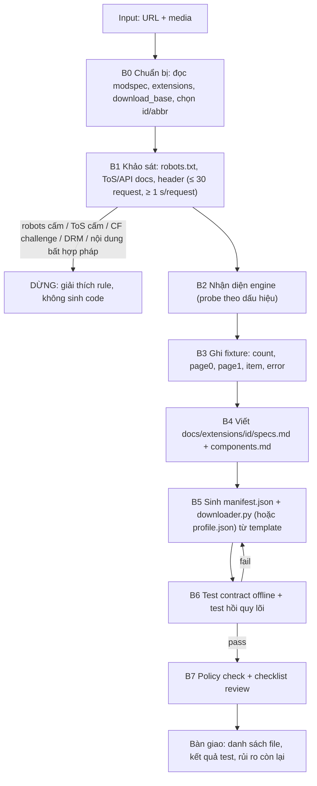
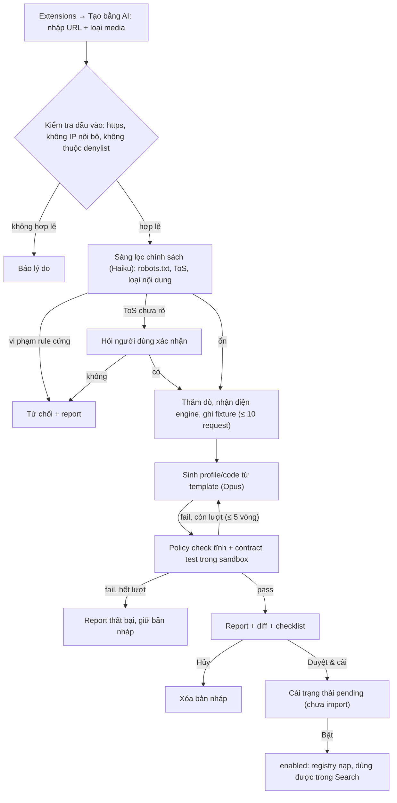
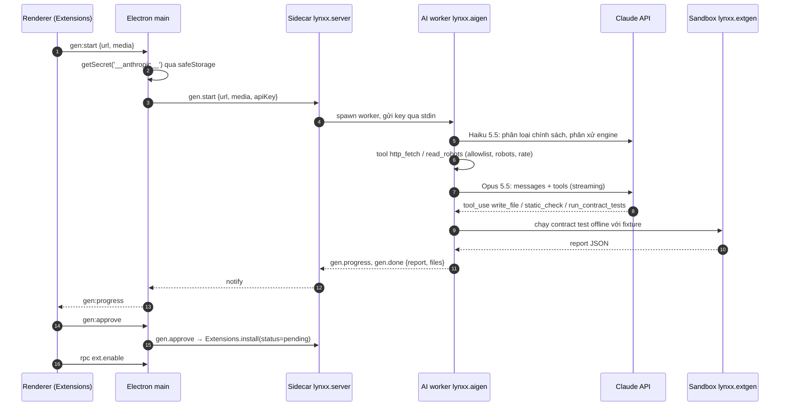
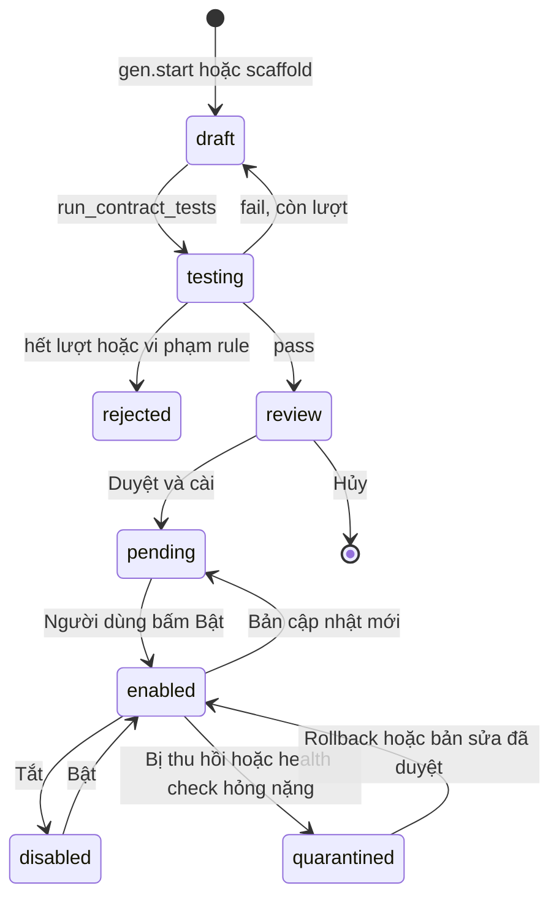

# Plan — Skill `new-site-extension` & tính năng "AI tạo extension"

> 2026-11-16 · Trạng thái: **đã triển khai phần lõi (2026-11-17), đợt 2: denylist domain, ký catalog, `lynxx.sdk`, eval**, xem [Trạng thái triển khai](#trạng-thái-triển-khai-2026-11-17) · Nhánh tham chiếu: `develop`
> Yêu cầu gốc (mục 5): tạo skill sinh specs/components khi thêm một web mới cần tải ảnh, âm thanh, video → thêm chức năng dùng AI phân tích một site, tạo downloader cho nó và tự đưa vào hệ thống như Extension.
> Phạm vi: `.claude/skills/`, `lynxx/` (lõi + extension), `extensions/`, `app/` (Electron), `docs/`.

## Trạng thái triển khai (2026-11-17)

Yêu cầu đã chốt với người dùng: đưa link một site → AI phân tích → sinh `manifest.json` + `downloader.py` → chạy thử → ra **một extension mới dạng bản nháp**. Cài vào app là thao tác riêng của người dùng, **không tự cài**.

| Hạng mục | Đã làm | Khác với plan |
|---|---|---|
| `lynxx/extgen` (QĐ1) | `fetch` (SafeFetcher), `engines` (8 engine nhận diện bằng probe), `templates` (7 template: `gelbooru_dapi`, `danbooru_json`, `e621_json`, `moebooru_json`, `philomena_json`, `szurubooru_json`, `shimmie_api`; 5 engine JSON / XML dựa trên lớp nền `lynxx/download_json.py`; mẫu `HTML_EXAMPLE` cho trang danh sách HTML), `policy` (AST), `sandbox` + `sandbox_boot` (audit hook, rlimit, proxy request), `scaffold`, CLI `survey / fetch / new / record / check / pack` | Contract test là bộ kiểm tra trong sandbox (load, rate, count, run, items, download, links, tags, dates, preview) cùng phép chạy lại offline so với `expected.json`, không phải `test_contract.py` viết tay. `DownloaderJsonApi` đóng vai `DeclarativeDownloader` của M2 ở dạng code (chưa có profile JSON khai báo). Shimmie không có API (chỉ HTML) và HTML tùy biến vẫn do AI / người viết, dựa trên `HTML_EXAMPLE` hoặc `rule34us`. `lynxx.sdk` có từ đợt 2 (dưới); chưa có `DeclarativeDownloader` / profile JSON |
| Skill A (`.claude/skills/new-site-extension`) | `SKILL.md` + `reference/` (safety-rules, engines, review-checklist), dùng CLI trên | Bản nháp nằm ở `.extgen-drafts/<id>/` (git bỏ qua), không ở `extensions/` vì CLI / GUI cũ tự nạp catalog |
| AI trong app (Phần B) | `lynxx/aigen` (worker, session, 9 tool, prompt, chế độ không AI), Electron: wizard ở trang Extensions, khoá Claude trong Cài đặt, danh sách bản nháp, chi tiết, xuất zip, "Cài vào app…" (kiểm tra lại + xác nhận) | Không có bước sàng lọc bằng Haiku và `ask_user`: ToS chưa rõ thì ghi vào bản tóm tắt để người dùng xem trước khi cài. Không có trạng thái `pending` sau khi cài, vì cài đã cần xác nhận riêng (R11). Ký số catalog (B.8) có từ đợt 2, dạng ký cả `index.json` (dưới) |
| Rule (Phần C) | R1, R2, R4, R5, R10, R11, R12, R13 thực thi bằng code; R3, R6, R7, R8 qua prompt + review; R9 do lõi (`safety.py`) và kiểm `tags`. Bộ test red-team offline (`RedTeamTests`): prompt injection với model "nghe lời" trang, SSRF địa chỉ nội bộ, robots cấm / 5xx, Cloudflare challenge, link HLS, đọc file người dùng từ sandbox, cookie đăng nhập trong manifest, đổi site, ngân sách request | Denylist domain và harness eval có từ đợt 2 (dưới); eval với Claude thật chưa chạy (tốn phí, để người dùng chạy) |
| Đóng gói | `lynxx-core aigen / extgen / sandbox`, mã tham khảo kèm ở `aigen_refs/`, `anthropic` kèm khi có | — |

Kiểm chứng: xem [dev_log 7m, 7n](../dev_log.md).

**Đợt 2 (2026-11-17), các mục còn mở của B.8 và Phần C:**

| Hạng mục | Đã làm | Khác với plan |
|---|---|---|
| Denylist domain (R8, A.2 / R7) | `lynxx/safety_data/denied_domains.txt` (không phải `lynxx/safety/`, vì `lynxx/safety.py` là module): dịch vụ streaming thương mại / có DRM (R7: YouTube, Netflix, Spotify, Disney+, Apple TV / Music…), site đăng lại nội dung trả phí (R6), chỗ cho site bất hợp pháp (R8, ghi dạng `sha256:` để không in tên). `lynxx/denylist.py` so tên miền và mọi tên miền con ở mọi dạng host (chữ hoa, dấu chấm cuối, `%xx`, punycode, full-width…). Chặn ở chuẩn hoá link site (survey / fetch / new / phiên AI, trước mọi request và lời gọi model), mọi request của `SafeFetcher` (kể cả redirect), kiểm tra offline bản nháp, mọi đường cài và lúc nạp; app hiện lời nhắn tiếng Việt và huy hiệu "bị chặn" | Danh sách R8 cụ thể do người bảo trì thêm từ nguồn tin cậy; IP của tên miền bị chặn không được dò ngược |
| Ký catalog (B.8) | Ed25519 Python thuần (`lynxx/ed25519.py`, RFC 8032, test vector; `cryptography` không có trong venv lẫn lõi đóng băng nên không thêm phụ thuộc). Người bảo trì ký byte của `index.json` → `index.json.sig` (`tools/sign_catalog.py`, khoá PKCS#8 PEM như OpenSSL, tuỳ chọn `expires`). `lynxx/trust.py` kiểm với khoá đi kèm (`lynxx/safety_data/catalog_keys.json`) trước khi đọc mục; chưa ký / ký sai / khoá lạ / hết hạn → từ chối cả catalog. Cài từ catalog từ xa: renderer chỉ gửi id, main lấy URL + sha256 từ catalog đã kiểm, lõi kiểm lại và ghim sha256 người dùng đã xác nhận, id trong archive phải khớp mục | Không ký từng mục (`contentSha256`, `signature` mỗi mục) và chưa có `revoked` / `quarantined`: chữ ký index đã phủ sha256 của mọi archive. `catalog_keys.json` là danh sách rỗng giữ chỗ: người bảo trì thêm khoá thật (docs/operations.md mục 3d). Ngoại lệ cho nhà phát triển chỉ qua biến môi trường |
| `lynxx.sdk` (QĐ3, M2) | `lynxx/sdk.py`, `SDK_VERSION` 1.0: lớp nền downloader, `JsonPost`, kiểu, hằng số, regex item chung, helper mạng được phép. Manifest có `minSdkVersion` (kiểm khi cài và khi nạp, lời nhắn rõ). Template, `HTML_EXAMPLE`, prompt AI, tài liệu tham khảo `sdk` và skill dùng `lynxx.sdk`; policy cho phép import này | Extension cũ (catalog `extensions/`) vẫn import thẳng `lynxx.defines` / `lynxx.rex`, chưa chuyển sang SDK. Allowlist import chưa bị thu hẹp chỉ còn `lynxx.sdk` |
| Eval với model thật (M3) | `python -m lynxx.aigen.eval run / estimate`: bộ site `lynxx/aigen/eval_sites.json`, tỉ lệ đạt, chi phí từ `usage`, lượt model, bước tool, request, thời gian, lỗi; ghi fixture từ lần chạy thật (`--live --record`) và phát lại offline (`--fixtures`); chế độ template, model giả lập, AI (cần `--confirm-cost`, dừng ở tổng trần chi phí) | Chưa chạy với Claude thật (tốn phí của người dùng); bộ site là site đã chạy thật ở 7m / 7n cộng hai site HTML cho chế độ AI, chưa có "8 module + 3 site mới" |

## Mục lục

0. [Tóm tắt & quyết định thiết kế](#0-tóm-tắt--quyết-định-thiết-kế)
1. [Hiện trạng & khoảng trống](#1-hiện-trạng--khoảng-trống)
2. [Phần A — Claude Code skill `new-site-extension`](#2-phần-a--claude-code-skill-new-site-extension)
3. [Phần B — Tính năng "AI tạo extension" trong app](#3-phần-b--tính-năng-ai-tạo-extension-trong-app)
4. [Phần C — An toàn & tuân thủ (rule cứng của generator)](#4-phần-c--an-toàn--tuân-thủ-rule-cứng-của-generator)
5. [Phần D — Lộ trình](#5-phần-d--lộ-trình)
6. [Câu hỏi mở](#6-câu-hỏi-mở)

---

## 0. Tóm tắt & quyết định thiết kế

Hai sản phẩm dùng chung **một bộ công cụ** (`lynxx/extgen/`): (A) một Claude Code skill để lập trình viên thêm site thủ công có AI hỗ trợ trong repo; (B) một wizard trong app Electron để người dùng cuối nhập URL và nhận extension đã qua test, chờ duyệt rồi mới bật. Cả hai đều bị ràng buộc bởi cùng một bộ **rule cứng** (Phần C), được thực thi bằng code chứ không chỉ bằng prompt.

| # | Quyết định | Lý do |
|---|---|---|
| QĐ1 | **Một nguồn sự thật**: template theo engine, policy check, contract test, sandbox nằm trong `lynxx/extgen/`; skill (A) và AI generator (B) chỉ là hai "người lái" khác nhau | Không phải bảo trì hai bộ quy tắc; mọi extension (người viết hay AI viết) qua cùng cổng kiểm tra |
| QĐ2 | **Khai báo trước, code sau**: với engine đã biết (Danbooru, e621, Gelbooru DAPI, Moebooru, Philomena, Szurubooru) AI chỉ sinh `profile.json` (endpoint, ánh xạ trường, phân trang, giới hạn) chạy bởi `DeclarativeDownloader` của lõi; chỉ sinh Python khi buộc phải (HTML tùy biến, API lạ) | Giảm mạnh bề mặt rủi ro thực thi code; dễ review; dễ sửa khi site đổi |
| QĐ3 | **SDK ổn định `lynxx.sdk` + allowlist import (AST)**: extension mới chỉ được import `lynxx.sdk`, một tập stdlib và `bs4`; mọi request mạng đi qua lớp network của lõi (`fetch_html`, `_download`) | Extension hiện tại phụ thuộc hằng số nội bộ (`lynxx.defines`, `lynxx.rex`); có allowlist mới thực thi được rate-limit, host allowlist, dừng khi gặp Cloudflare challenge |
| QĐ4 | **Không tin code chưa duyệt**: code sinh ra chỉ chạy trong sandbox process riêng (`python -I`, rlimit, audit hook, offline với fixture); cài ở trạng thái `pending` (không import) cho tới khi người dùng bấm Bật; trạng thái nằm ngoài manifest (`<data_dir>/extensions/.state.json`) | Hiện `_install_tree` → `_register` → `exec_module` chạy code ngay trong sidecar khi cài |
| QĐ5 | **An toàn thực thi ở lõi, không giao cho extension**: blacklist cứng tag liên quan trẻ vị thành niên (bộ lọc riêng `-safety_blacklist`, mặc định tắt, quyết định 2026-11-18), sàn rate-limit, `Retry-After`, `is_cloudflare_challenge`, allowlist host đều nằm trong pipeline lõi, extension không tắt được | Extension (nhất là AI viết) là mã không tin cậy |
| QĐ6 | **AI service chạy trong Python worker riêng** do sidecar quản lý, gọi Claude API qua tool use (client-side tools tự cài đặt, không dùng server `web_fetch`); key từ Electron `safeStorage` đi qua stdin, không bao giờ tới renderer/sandbox | Tool phía client mới tôn trọng được robots.txt, giới hạn domain/kích thước/tốc độ và ghi fixture cục bộ |

---

## 1. Hiện trạng & khoảng trống

### 1.1. Hợp đồng extension hiện có (đã đọc code)

- **Manifest** (`lynxx/modspec.py`, `ExtensionManifest`): bắt buộc `id` (`^[a-z][a-z\d_-]{1,31}$`), `name`, `abbr` (`^[a-z][a-z\d]{1,3}$`), `version` (semver), `entry` (`downloader.py:Class` hoặc `lynxx.module:Class` — dạng module chỉ cho builtin); tùy chọn `site`, `media` (`image`/`video`/`audio`), `tagList`, `auth` (`apiKey`, `apiKeyFormat`, `cookies`), `syntax` (`TagSyntax`: `concat` ∈ {`+`, ` `}, `idSep` ∈ {`:`, `=`}, `maxTags`, `maxWildcards`, `freeMetaPrefixes`, `localPositiveOverflow`, regex `metaCount/sort/fav/pool`), `sha256`. Trường lạ bị từ chối, **trừ khóa bắt đầu bằng `$`**. `apiVersion` = 1.
- **Registry** (`lynxx/extensions.py`): nạp builtin (`lynxx/builtin_ext/<id>/`), user (`<data_dir>/extensions/<id>/`), catalog repo (`extensions/<id>/`); cài từ thư mục / catalog / zip (sha256 bắt buộc, chống zip-slip, ≤ 10 MB) / URL; `_register` gọi `ProcModule.register(abbr)` (id ngoài ≥ 100), `register_module_syntax`, `register_module_limits`, `register_module_prefix`, đặt `IDVAL_EQ_SEPARATORS`/`TAG_SEPARATORS`.
- **Downloader** (`lynxx/download_base.py` → `download.py`): ~30 hàm abstract (`_form_tags_search_address`, `_form_page_num_address`, `_get_items_query_size_or_html`, `_get_all_post_tags`, `_extract_id`, `_is_video`, `_extract_item_info`, `_extract_post_date`, `_get_image_address`/`_get_video_address`, …) + hook mới `CAPABILITIES` (`ModuleCaps`), `_parses_raw_pages`, `_supports_native_date_filter`, `_get_page_fetch_delay`, `_get_min_request_interval`, `_use_chunked_download`, `_fix_link_after_download_error`, `extract_preview_url`. Engine JSON (mẫu `download_db.py`) chuyển mỗi post thành chuỗi raw dạng thẻ `<post_id="…" file_url="…" sample_url="…" preview_url="…" created_at="…" tags="…">` để regex lõi (`re_orig_file_link`, `re_item_info_part_xml`) xử lý.
- **Network** (`lynxx/network.py`): `parse_retry_after` (trần `RETRY_AFTER_MAX_SECONDS` = 120), `is_cloudflare_challenge` (`cf-mitigated: challenge` → dừng, kèm `CF_CHALLENGE_HINT`), `_respect_rate_limit` dựa trên `_get_min_request_interval`.
- **App**: sidecar JSON-RPC `lynxx/server.py` (`ext.list`, `ext.install`, `ext.uninstall`, `ext.remoteCatalog`, `search.count`, `search.preview`…); `app/main.js` giữ secrets bằng `safeStorage` (`setSecret`/`getSecret`, fallback plain text có báo UI), allowlist method RPC, chèn API key ở main (`tags:update`), renderer không bao giờ thấy key (`app/preload.js`).
- **Test**: `lynxx/tests/test_lynxx.py` — `ManifestTests`, `ExtensionInstallTests` (cài từ thư mục/zip, zip-slip, builtin không thay được), `DanbooruParsingTests` (parse JSON từ dữ liệu ghi sẵn, offline).

### 1.2. Khoảng trống cần lấp

| # | Khoảng trống | Bằng chứng | Xử lý (phase) |
|---|---|---|---|
| G1 | Extension phụ thuộc hằng số/regex nội bộ của lõi | `extensions/bbooru/downloader.py` import `MODULE_ABBR_BB`, `SITENAME_B_BB` từ `lynxx.defines`, `re_post_page_bb` từ `lynxx.rex` — site mới không thể thêm hằng số vào lõi | `lynxx.sdk` (M2) |
| G2 | Chưa có harness contract test chung; chỉ Danbooru có test parse | `DanbooruParsingTests` | `lynxx/extgen/contract.py` (M1 thủ công → M2 chung) |
| G3 | Code extension user được import ngay khi cài/khởi động, không có trạng thái duyệt | `_install_tree` → `_register` → `spec.loader.exec_module`; `ensure_loaded` nạp cả user dir | trạng thái `pending` (M2) |
| G4 | Không có allowlist host; extension có thể dùng thư viện mạng trực tiếp | `extensions/rule34us` import từ `requests` (hiện chỉ `exceptions`) | manifest `hosts` + policy AST (M2) |
| G5 | Media nhị phân ảnh/video dù manifest cho phép `audio` | `_is_video`, `KNOWN_EXTENSIONS_VID/IMG`, `-skip_img/-skip_vid`, `isVideo` trong `search.preview` | mục A.10 (M2) |
| G6 | Schema `docs/schemas/extension-manifest.schema.json` có `additionalProperties: false` | khóa `$generator` hay trường mới sẽ bị editor báo lỗi | thêm `patternProperties` `^\$`, `hosts`, apiVersion 2 (M2) |
| G7 | Trường `sha256` của manifest tự tham chiếu | `_install_tree` so `m.sha256` với sha256 của **archive chứa chính manifest** → chỉ dùng được khi để trống | `contentSha256` tính toán + chữ ký (M4) |
| G8 | Không có lịch sử phiên bản / rollback | `_install_tree` `rmtree(dest)`; bản mới cần restart | `.history/` (M2) |
| G9 | Không có blacklist an toàn ở lõi; nhánh debug của e621 dựng URL CDN cho post mà site giữ lại theo blacklist mặc định ("young -rating:s") | `extensions/e621/downloader.py` khoảng dòng 150–156 (`__LYNXX_DEBUG__`) | nhánh e621 **đã xóa 2026-11-16**; blacklist lõi chạy khi lọc (M1, **P0**) |
| G10 | Rate-limit là opt-in | `_get_min_request_interval` mặc định `0.0` | sàn cho extension không builtin (M2) |

---

## 2. Phần A — Claude Code skill `new-site-extension`

### A.1. Mục tiêu

Biến việc "thêm một site" thành quy trình lặp lại được trong ~1–2 giờ: khảo sát hợp lệ → nhận diện engine → viết `specs.md`/`components.md` → sinh `manifest.json` + `downloader.py` (hoặc `profile.json` sau M2) từ template đúng base class → test contract offline với fixture ghi sẵn → checklist review. Skill **không** cài, không bật, không commit — người dùng quyết định.

### A.2. Khi nào kích hoạt

- Người dùng nói: "thêm site/web mới", "tạo extension/downloader cho <URL>", "hỗ trợ <site> trong Lynxx", "add a new site / booru extension".
- Người dùng đưa URL một kho ảnh/âm thanh/video và hỏi Lynxx có tải được không.
- **Không** kích hoạt cho: sửa extension đã có (dùng quy trình bình thường), site streaming thương mại (YouTube, Spotify, Netflix…) — trả lời ngay theo rule R7.

### A.3. Input

| Trường | Bắt buộc | Ghi chú |
|---|---|---|
| `url` | có | trang chủ hoặc trang docs API; chỉ `https` |
| `media` | có (mặc định `image`,`video`) | một hoặc nhiều trong `image`, `video`, `audio` |
| `id`, `abbr`, `name` | không | skill đề xuất, kiểm tra trùng với `extensions/*`, `lynxx/builtin_ext/*`, `MODULE_ABBR_*` |
| ghi chú auth | không | chỉ khai báo `auth.apiKey` khi site có API key chính thức; **không** xin key/mật khẩu trong chat |

### A.4. Quy trình



### A.5. Nhận diện engine → template → base class

| Engine | Dấu hiệu probe (1–2 request) | Phân trang / đếm | Base class | Mẫu trong repo |
|---|---|---|---|---|
| Gelbooru DAPI | `index.php?page=dapi&s=post&q=index&limit=1` trả XML `<posts count="N">` | `pid=n`; count từ thuộc tính `count` | `lynxx.download_gelbooru.DownloaderGelbooru` | `extensions/xbooru`, `extensions/bbooru`, `lynxx/download_rx.py` |
| Danbooru | `posts.json?limit=1` → mảng có `tag_string`; có `counts/posts.json` | `page=n+1`; giới hạn tag ẩn danh | `Downloader` (theo `download_db.py`), hoặc kế thừa `DownloaderDb` nếu là bản sao gần như y hệt (như `DownloaderZz` trong test) | `lynxx/download_db.py` |
| e621/e926 | `posts.json?limit=1` → `{"posts":[{"file":{…},"tags":{…}}]}`; yêu cầu User-Agent mô tả | `page`; không có endpoint count rẻ | `Downloader` | `extensions/e621` |
| Moebooru | `post.json?limit=1` → mảng có `file_url`, `jpeg_url`, `sample_url` | `page=n+1`; count qua `post.xml?limit=0` | `Downloader` (JSON) | template mới `moebooru_json` |
| Shimmie2 | chân trang "Shimmie", `/post/list/<tags>/<page>`, có thể `/api/danbooru/find_posts` | HTML theo trang hoặc API danbooru-compat | `Downloader` | `extensions/paheal` (API), `extensions/rule34hentai` (HTML) |
| Philomena | `api/v1/json/search/images?q=*&per_page=1` → `{"images":[…],"total":N}`, `representations` | `page`, `per_page`; tag nối bằng dấu phẩy → giữ `syntax.concat` = `+` và chuyển đổi trong `_form_tags_search_address` | `Downloader` (JSON) | template mới `philomena_json` |
| Szurubooru | `api/posts/?query=&limit=1` với `Accept: application/json` → `{"results":[…],"total":N}`, `contentUrl`, `thumbnailUrl` | `offset=n*limit` | `Downloader` (JSON) | template mới `szurubooru_json` |
| HTML tùy biến | không khớp các mục trên | trang listing | `Downloader` | `extensions/rule34us` |
| JSON tùy biến | API riêng có tài liệu | theo docs | `Downloader` | `download_db.py` |

Thuật toán: chạy probe theo thứ tự rẻ nhất (mỗi probe ≤ 1 request, đã qua robots), dừng ở dấu hiệu đầu tiên khớp chắc chắn; ghi bằng chứng (URL + trích đoạn response) vào `specs.md`. Trường hợp mơ hồ: hỏi người dùng (skill) hoặc dùng Haiku phân xử (app).

### A.6. Cấu trúc thư mục

```text
.claude/skills/new-site-extension/
  SKILL.md                      # bản nháp ở A.11
  reference/
    engines.md                  # bảng A.5 chi tiết: endpoint, field, quirk
    hook-map.md                 # hook DownloaderBase phải override theo engine
    safety-rules.md             # bản sao Phần C (R1–R13)
    review-checklist.md         # A.9
lynxx/extgen/                  # dùng chung cho skill và app (QĐ1)
  __main__.py                   # python -m lynxx.extgen probe|detect|scaffold|check|pack
  probe.py                      # fetch có giới hạn + robots + ghi fixture
  engines.py                    # heuristic nhận diện engine
  scaffold.py                   # render template -> extensions/<id>/
  policy.py                     # AST allowlist / denylist (R5, R10)
  contract.py                   # harness contract test (M2)
  sandbox_boot.py               # bootstrap process sandbox (M3)
  templates/
    common/  manifest.json.tmpl  specs.md.tmpl  components.md.tmpl  test_contract.py.tmpl  expected.json.tmpl
    gelbooru_dapi/  danbooru_json/  e621_json/  moebooru_json/  shimmie_api/  shimmie_html/
    philomena_json/  szurubooru_json/  custom_json/  custom_html/      # mỗi thư mục: downloader.py.tmpl (+ profile.json.tmpl)
docs/extensions/<id>/
  specs.md  components.md  survey/robots.txt  survey/notes.md
extensions/<id>/
  manifest.json  downloader.py | profile.json
  tests/test_contract.py  tests/expected.json  tests/fixtures/{count,page0,page1,item_*,error}.{json,xml,html}
```

Fixture đi kèm extension (được copy khi cài) để app chạy lại contract test khi cài/cập nhật. Giới hạn: mỗi file ≤ 256 KB, tổng ≤ 1 MB, chỉ metadata dạng text (không file media), đã xóa token/khóa/tên đăng nhập.

### A.7. Khung `specs.md` và `components.md`

`docs/extensions/<id>/specs.md`:
1. Tổng quan site (engine, loại media, ví dụ truy vấn).
2. Pháp lý & chính sách: robots.txt (đường dẫn được phép), ToS/API terms (URL + tóm tắt), rate limit công bố, `Crawl-delay`, yêu cầu User-Agent, kết luận R1–R9.
3. Endpoint: search, page, count, item, comments (nếu có); ví dụ URL thật đã probe.
4. Cú pháp tag & giới hạn → ánh xạ sang `syntax` (`concat`, `idSep`, `maxTags`, `maxWildcards`, `freeMetaPrefixes`, `localPositiveOverflow`, regex).
5. Ánh xạ trường → `ItemInfo` (`id`, `tags`, `ext`, `width`, `height`, `score`, `md5`, `source`, `parent_id`, `has_children`, `date`).
6. Media: chọn URL gốc/sample/preview, `low_res`, phân loại `image/video/audio`, đuôi file.
7. Ngày: định dạng nguồn, múi giờ → `FMT_DATE` (`%d-%m-%Y`); có lọc ngày phía server không (`_supports_native_date_filter`).
8. Lỗi & trường hợp biên: post bị xóa/hạn chế, trang quá tải (`_is_search_overload_page`), JSON lỗi, giới hạn độ sâu (`_get_max_search_depth`).
9. Ngoài phạm vi.

`docs/extensions/<id>/components.md`: bảng **bản đồ hook** (mỗi hook của `DownloaderBase` → "template mặc định / override / NotImplemented" + lý do), hằng số cục bộ, regex, `CAPABILITIES`, giá trị `_get_min_request_interval`/`_get_page_fetch_delay`, danh sách fixture và test nào phủ hook nào.

### A.8. Test contract (M1: viết tay theo mẫu `test_lynxx.py`)

Mỗi extension có `tests/test_contract.py` chạy **offline**: đặt `LYNXX_DATA_DIR` tạm, `Extensions.install_from_dir`, lấy `pid` từ `ProcModule.PROC_MODULES_BY_NAME[abbr]`, `_make_downloader(pid)`, thay `fetch_html` bằng router trả `HTMLContent` từ fixture, chặn socket.

```python
FIX = pathlib.Path(__file__).parent / 'fixtures'
EXT_DIR = pathlib.Path(__file__).resolve().parents[1]
EXPECTED = json.loads((pathlib.Path(__file__).parent / 'expected.json').read_text(encoding='utf-8'))


class ContractTests(TestCase):
    def setUp(self) -> None:
        self.tmp = tempfile.TemporaryDirectory()
        self.patches = [mock.patch.dict(os.environ, {'LYNXX_DATA_DIR': self.tmp.name}),
                        mock.patch('socket.socket', side_effect=OSError('network is disabled in contract tests'))]
        for p in self.patches:
            p.start()
        Extensions.ensure_loaded()
        self.pid = ProcModule.PROC_MODULES_BY_NAME[Extensions.install_from_dir(EXT_DIR).abbr]

    def _route(self, url: str, **_) -> HTMLContent | None:
        name = next((r['fixture'] for r in EXPECTED['routes'] if r['match'] in url), None)
        self.assertIsNotNone(name, f'unexpected request: {url}')  # C2: địa chỉ phải khớp request đã ghi
        raw = (FIX / name).read_bytes()
        return HTMLContent(BeautifulSoup(raw, 'html.parser'), raw)
```

Các kiểm tra (đánh số dùng chung với M2/M3):

| ID | Kiểm tra | Hook liên quan |
|---|---|---|
| C1 | Manifest hợp lệ (`ExtensionManifest.load`), `abbr` không trùng, `media` khớp fixture | `modspec` |
| C2 | Địa chỉ search/page/count khớp route đã ghi (không phát sinh request lạ) | `_form_tags_search_address`, `_form_page_num_address`, `_consume_custom_module_tags` |
| C3 | Đếm kết quả đúng | `_get_items_query_size_or_html` |
| C4 | Parse trang: đúng số item; fixture lỗi → `[]`; trang quá tải được nhận ra | `_get_all_post_tags`, `_is_search_overload_page` |
| C5 | Id đúng | `_extract_id`, `_local_addr_from_string` |
| C6 | Item info đúng; `tags` không rỗng (cần cho blacklist R9) | `_extract_item_info` |
| C7 | URL file + đuôi đúng, cả `low_res`; phân loại media đúng | `_get_image_address`, `_get_video_address`, `_is_video` / `_media_kind` |
| C8 | Ngày parse đúng `%d-%m-%Y`, đúng múi giờ | `_extract_post_date` |
| C9 | Preview URL tuyệt đối, `https`, thuộc host cho phép | `extract_preview_url` |
| C10 | An toàn: interval ≥ sàn và ≥ `Crawl-delay`; `CAPABILITIES` ⊂ `ModuleCaps`; item mẫu dính blacklist bị lõi loại | `_get_min_request_interval`, pipeline lõi |
| C11 | Cú pháp tag: regex compile, `parse_tags` với giới hạn của module cho kết quả đúng | `syntax`, `register_module_limits` |

Lệnh chạy: `python -m unittest discover -s extensions/<id>/tests -p 'test_*.py'` từ gốc repo, kèm hồi quy `python -m unittest lynxx.tests.test_lynxx`. Smoke test live (1 count + 1 page thật) chỉ chạy thủ công, opt-in, không bao giờ trong CI.

### A.9. Checklist review

- [ ] robots.txt cho phép mọi đường dẫn extension dùng; `Crawl-delay` đã phản ánh.
- [ ] ToS/API terms không cấm truy cập tự động; URL ToS ghi trong `specs.md`.
- [ ] `_get_min_request_interval()` ≥ sàn (1.0 s HTML / 0.5 s API) và ≥ giới hạn công bố.
- [ ] Không vượt CAPTCHA/Cloudflare/bot-detection; không xoay User-Agent; không khai báo `cf_clearance` trong `auth.cookies`.
- [ ] Không dựng URL CDN để lấy file mà API không trả (bị xóa / hạn chế / blacklist mặc định / trả phí).
- [ ] Không DRM, không HLS/DASH mã hóa; chỉ URL file trực tiếp.
- [ ] Import chỉ trong allowlist; không `eval/exec/compile/__import__/subprocess/socket/pickle/ctypes`; không đọc/ghi file.
- [ ] Hằng số/regex định nghĩa cục bộ, không sửa `lynxx/defines.py`, `lynxx/rex.py`.
- [ ] Chuỗi raw item escape dấu `"` (thay bằng `'`) như `download_db.py`; regex không có lượng từ lồng nhau (ReDoS).
- [ ] `CAPABILITIES` chỉ khai báo tính năng có thật (PREVIEW, DATE_FILTER, COMMENTS…).
- [ ] Contract C1–C11 pass offline; test hồi quy lõi pass.
- [ ] Fixture ≤ 1 MB, không media, không token; `specs.md`/`components.md` đầy đủ.

### A.10. Media âm thanh: lõi cần mở rộng gì

> **Đã làm (2026-11-17, dev log 7p), bản gọn hơn bảng dưới:** `KNOWN_EXTENSIONS_AUD`, `MediaKind`, `media_kind_by_ext` (`defines.py`); hook `_media_kind` + `_subfolder_for` (`DownloaderBase`, mặc định suy từ `_is_video`; `DownloaderJsonApi` phân loại theo đuôi); `-skip_aud`, `-audsub`; `_filter_items_by_type` lọc 3 loại; tải theo khối cho video **và** âm thanh; `search.preview` trả `mediaKind`; UI: ô "Âm thanh" (chỉ hiện với module có media `audio`), badge "♪ âm thanh", ô thay thế khi không có ảnh bìa; `file_sorter` có thư mục `audio`. Chưa làm: chip lọc theo loại trong Preview, phát thử âm thanh.

Manifest đã chấp nhận `"media": ["audio"]` (`KNOWN_MEDIA` trong `modspec.py`), nhưng pipeline phân loại nhị phân bằng đuôi file và `_is_video`. Thay đổi đề xuất (M2, tương thích ngược với 8 module hiện có):

| Chỗ | Hiện tại | Thay đổi |
|---|---|---|
| `lynxx/defines.py` | `KNOWN_EXTENSIONS_VID = ('mp4','webm')`, `KNOWN_EXTENSIONS_IMG = (...)` | thêm `KNOWN_EXTENSIONS_AUD = ('mp3','ogg','oga','opus','flac','m4a','wav')`, gộp vào `KNOWN_EXTENSIONS`/`KNOWN_EXTENSIONS_STR`; thêm `class MediaKind` (`IMAGE`, `VIDEO`, `AUDIO`) và `media_kind_by_ext()`. `ogg`/`webm` mơ hồ → mặc định theo đuôi, extension override được |
| `DownloaderBase` | `_is_video(h)` abstract | thêm hook không abstract `_media_kind(h) -> str`, mặc định suy từ `_is_video` + đuôi audio; extension mới implement `_media_kind`, `_is_video` = `_media_kind(h) == VIDEO` |
| `download.py` | `_process_image`/`_process_video` → `_send_to_download(raw, item_id, is_video)` | thêm `_process_audio`; SDK base có `_subfolder_for(kind)` và `_send_to_download` tổng quát; chữ ký cũ giữ nguyên cho extension cũ (không khai báo audio nên không bị ảnh hưởng) |
| Tham số | `-skip_img`, `-skip_vid`, `-imgsub`, `-vidsub` | thêm `-skip_aud`, `-audsub`; `skip_audio`, `subfolder_aud`; `_filter_items_by_type` lọc 3 loại |
| `network.py` | `is_video_ext = ext_full in KNOWN_EXTENSIONS_VID` quyết định tải chunked | đổi thành "audio hoặc video"; docstring `_use_chunked_download` cập nhật |
| `file_searcher.py`, `gui_base.py` | `EXTENSIONS_SET`, file dialog dùng `KNOWN_EXTENSIONS` | tự động có đuôi audio sau khi gộp |
| `server.py` `search.preview` | trả `isVideo` | thêm `mediaKind`, giữ `isVideo` cho tương thích |
| UI `app/` | `d.images/d.videos` → `-skip_img/-skip_vid`; badge "▶ video" | setting `download.audio` → `-skip_aud`; ô subfolder audio; badge "♪ audio"; chip lọc Ảnh/Video/Âm thanh; thẻ preview audio dùng placeholder (không phát trực tiếp ở MVP); chỉ hiện toggle cho loại có trong `manifest.media` |
| Ghi chú | `_filter_existing_items` chỉ quét thư mục gốc, không quét subfolder | áp dụng cho cả ba loại; ghi vào danh sách cải tiến, không chặn M2 |

Trước M2, skill phải báo người dùng; nếu vẫn muốn, tạm xử lý audio qua đường video (`_is_video` trả `True` cho đuôi audio, file vào subfolder video) và ghi `TODO(audio-M2)`.

### A.11. Bản nháp hoàn chỉnh `SKILL.md`

Lưu tại `.claude/skills/new-site-extension/SKILL.md`. Viết để dùng được **ngay hôm nay** (dựa vào extension mẫu có sẵn); khi `lynxx/extgen` có rồi thì dùng các lệnh của nó.

````markdown
---
name: new-site-extension
description: Tạo extension downloader mới cho Lynxx khi người dùng muốn thêm một website (booru, kho ảnh/âm thanh/video) để tải nội dung — khảo sát API/robots.txt/ToS, nhận diện engine (Danbooru, e621, Gelbooru DAPI, Moebooru, Shimmie, Philomena, Szurubooru, HTML tùy biến), viết docs/extensions/<id>/specs.md + components.md, sinh extensions/<id>/manifest.json + downloader.py từ mẫu, viết test contract offline với fixture và chạy checklist review. Dùng khi người dùng nói "thêm site/web mới", "tạo extension/downloader cho <URL>", "add a new site", "support <site> in Lynxx", "new booru extension".
---

# new-site-extension

Bạn thêm một site vào Lynxx dưới dạng extension `extensions/<id>/`. Làm đúng thứ tự; mỗi bước có điều kiện DỪNG. Không cài, không bật, không commit — người dùng tự quyết.

## Quy tắc cứng (vi phạm bất kỳ điều nào → DỪNG, giải thích, không sinh code)
1. Chỉ API/trang công khai mà khách ẩn danh truy cập được, hoặc API chính thức bằng API key của chính người dùng (`auth.apiKey`). Không luồng đăng nhập bằng mật khẩu, không cookie/tài khoản người khác, không vượt paywall.
2. robots.txt phải cho phép mọi đường dẫn extension dùng; ToS cấm truy cập tự động / tải hàng loạt → DỪNG.
3. `_get_min_request_interval()` ≥ max(giới hạn công bố, Crawl-delay, 1.0 s cho HTML, 0.5 s cho API JSON). Không vô hiệu `Retry-After` của lõi.
4. Không vượt CAPTCHA/bot-detection/Cloudflare challenge: không cloudscraper, curl_cffi, selenium, playwright, giải JS, giả TLS fingerprint, xoay User-Agent. Thấy header `cf-mitigated: challenge` → DỪNG (lõi có `is_cloudflare_challenge` để dừng lúc chạy).
5. Không gỡ DRM, không site streaming có DRM, không HLS/DASH mã hóa. Chỉ tải URL file trực tiếp mà API/trang trả về; không tự dựng URL CDN để lấy file site giữ lại.
6. Từ chối site có nội dung bất hợp pháp. Không nới, không lách blacklist cứng về trẻ vị thành niên của lõi.
7. Code: chỉ import stdlib (`re`, `json`, `datetime`, `base64`, `typing`, `collections.abc`, `urllib.parse`, `multiprocessing.dummy`), `bs4`, `lynxx.*` (khi có `lynxx.sdk` thì chỉ `lynxx.sdk`). Cấm `eval/exec/compile/__import__/importlib/pickle/marshal/subprocess/os.system/ctypes/socket`, cấm gọi `requests` trực tiếp, cấm đọc/ghi file. Mạng chỉ qua `fetch_html`/`_download` của lõi.
8. Không xin mật khẩu/API key trong chat; không lưu secret vào fixture hay tài liệu.

## Input
- `url` (bắt buộc, https), `media`: image | video | audio (mặc định image+video).
- Tùy chọn: `id` (`^[a-z][a-z\d_-]{1,31}$`), `abbr` (`^[a-z][a-z\d]{1,3}$`), `name`. Thiếu `url`/`media` → hỏi.

## B0 — Chuẩn bị
- Đọc `lynxx/modspec.py`, `lynxx/extensions.py`, `lynxx/download_base.py`, `docs/plans/site-extension-skill-and-ai-generator.md` (Phần A, C).
- Chọn `id`/`abbr` chưa dùng: kiểm tra `extensions/*/manifest.json`, `lynxx/builtin_ext/*/manifest.json`, `MODULE_ABBR_*` trong `lynxx/defines.py`.
- Nếu `python -m lynxx.extgen --help` chạy được, dùng `probe/detect/scaffold/check` thay cho thao tác tay bên dưới.

## B1 — Khảo sát (tối đa 30 request, nghỉ ≥ 1 s giữa các request)
```bash
UA='Lynxx-extgen/0.1 (+local dev)'
curl -sS -A "$UA" --max-time 20 --max-filesize 2000000 -D - -o /dev/null "https://HOST/robots.txt"
```
- Lưu robots.txt vào `docs/extensions/<id>/survey/robots.txt`; kiểm tra đường dẫn search/count/item.
- Tìm ToS/API docs (`/terms`, `/tos`, `/help/api`, `/wiki/api`…), ghi URL + tóm tắt ngắn (không chép nguyên văn dài) vào `survey/notes.md`.
- Không gửi cookie, không đăng nhập, không tải file media (cần Content-Type thì dùng `-I` hoặc `-r 0-65535`).
- Gặp challenge/CAPTCHA, DRM, paywall, nội dung bất hợp pháp → DỪNG.

## B2 — Nhận diện engine
| Engine | Probe | Base class | Mẫu |
|---|---|---|---|
| Gelbooru DAPI | `index.php?page=dapi&s=post&q=index&limit=1` → XML `<posts count=` | `lynxx.download_gelbooru.DownloaderGelbooru` | `extensions/xbooru`, `extensions/bbooru` |
| Danbooru | `posts.json?limit=1` → mảng có `tag_string` | `lynxx.download.Downloader` | `lynxx/download_db.py` |
| e621 | `posts.json?limit=1` → `{"posts":[{"file":…}]}` | `Downloader` | `extensions/e621` |
| Moebooru | `post.json?limit=1` → mảng có `jpeg_url` | `Downloader` | theo `download_db.py` |
| Shimmie2 | footer "Shimmie", `/post/list/…` | `Downloader` | `extensions/paheal`, `extensions/rule34hentai` |
| Philomena | `api/v1/json/search/images?q=*&per_page=1` | `Downloader` | theo `download_db.py` |
| Szurubooru | `api/posts/?limit=1` + `Accept: application/json` | `Downloader` | theo `download_db.py` |
| HTML tùy biến | không khớp | `Downloader` | `extensions/rule34us` |
Ghi kết luận + bằng chứng (URL, trích đoạn) vào specs.md. Mơ hồ → hỏi người dùng.

## B3 — Ghi fixture
`extensions/<id>/tests/fixtures/`: `count.*`, `page0.*`, `page1.*`, `item_<id>.*` (nếu engine cần trang item), `error.*` (lấy thật hoặc dựng theo docs). Mỗi file ≤ 256 KB, tổng ≤ 1 MB, chỉ text, xóa token/khóa/tên đăng nhập. Ghi `tests/expected.json`: `routes` (chuỗi con URL → fixture), `count`, số item mỗi trang, giá trị mong đợi của item đầu (id, ext, date, file_url, preview, kind, tags chứa).

## B4 — Tài liệu
Viết `docs/extensions/<id>/specs.md` (tổng quan; pháp lý & chính sách; endpoint; cú pháp tag → `syntax`; ánh xạ trường → `ItemInfo`; media; ngày; lỗi & biên; ngoài phạm vi) và `components.md` (bản đồ hook DownloaderBase → template/override/NotImplemented; hằng số; regex; CAPABILITIES; rate; fixture ↔ test).

## B5 — Sinh code
- `manifest.json`: `$schema` = `../../docs/schemas/extension-manifest.schema.json`, `id`, `name`, `abbr`, `version` = `1.0.0`, `apiVersion` = 1, `kind` = `downloader`, `default` = false, `site`, `media`, `entry` = `downloader.py:Downloader<Abbr>`, `tagList` = `<abbr>_tags.json`, `description`, `auth` (chỉ khi có API key chính thức), `syntax`.
- `downloader.py`: kế thừa đúng base class; mọi hằng số/regex cục bộ (không sửa `lynxx/defines.py`, `lynxx/rex.py`); `CAPABILITIES` đúng thực tế; JSON → `_parses_raw_pages()` = True và chuyển mỗi post thành chuỗi `<post_id="…" file_url="…" sample_url="…" preview_url="…" created_at="…" tags="…">` (thay `"` bằng `'`, xem `download_db._get_all_post_tags`); `_get_min_request_interval` theo quy tắc 3; `_supports_native_date_filter` nếu site lọc ngày được.
- Audio: lõi chưa phân loại audio (xem plan mục A.10). Báo người dùng; nếu vẫn làm, xử lý audio qua đường video và ghi `TODO(audio-M2)`.

## B6 — Test
- Viết `extensions/<id>/tests/test_contract.py` theo mẫu `ExtensionInstallTests` + `DanbooruParsingTests` trong `lynxx/tests/test_lynxx.py`: `LYNXX_DATA_DIR` tạm, `Extensions.install_from_dir`, `_make_downloader(pid)`, patch `fetch_html` trả `HTMLContent` từ fixture, patch `socket.socket` để chặn mạng. Phủ C1–C11 (plan mục A.8).
- Chạy `python -m unittest discover -s extensions/<id>/tests -p 'test_*.py'` và `python -m unittest lynxx.tests.test_lynxx`. Sửa tới khi pass; không sửa test cho khớp code sai.

## B7 — Review
Đi qua checklist ở plan mục A.9; grep code tìm import/hàm cấm; báo mục nào chưa đạt.

## B8 — Bàn giao
Liệt kê file đã tạo, engine + bằng chứng, kết quả test, rate limit đã chọn, rủi ro còn lại, cách cài: app → Extensions (catalog cục bộ `extensions/` hiện site ở trạng thái chưa cài) → Cài → kiểm tra Preview.
````

---

## 3. Phần B — Tính năng "AI tạo extension" trong app

### B.1. Luồng người dùng



Màn hình report gồm: engine + độ tin cậy + bằng chứng; kết quả C1–C11; vi phạm policy (nếu có, kèm rule id và dòng code); robots/ToS/rate limit đã chọn; danh sách request đã thực hiện; file sinh ra (xem toàn bộ hoặc diff so với bản đang cài); chi phí token; checkbox "Tôi đã đọc và chịu trách nhiệm tuân thủ ToS của site".

### B.2. Kiến trúc



- **Worker riêng** (`python -m lynxx.aigen.worker`): phiên AI dài vài phút không chặn RPC search của sidecar; crash/hủy không ảnh hưởng sidecar. Sidecar giữ tối đa 1 phiên đồng thời.
- **Sandbox** (`python -I <repo>/lynxx/extgen/sandbox_boot.py`): `-I` bỏ qua `PYTHONPATH` nên bootstrap tự thêm repo root vào `sys.path`; env rỗng (không key, không proxy), cwd là thư mục tạm chứa bản sao bản nháp.
- **Phụ thuộc**: SDK Python `anthropic` là optional extra `[ai]` trong `pyproject.toml`; thiếu → nút "Tạo bằng AI" hiện hướng dẫn cài.

### B.3. AI worker: mô hình, vòng lặp, tool

**Phân vai mô hình** (giá tham khảo 11/2026, kiểm tra lại khi triển khai):

| Việc | Model | Cấu hình |
|---|---|---|
| Sàng lọc chính sách site, phân xử engine khi heuristic mơ hồ | `claude-haiku-5-5` ($0.10 / $0.50 mỗi MTok) | 1 lượt, `output_config.effort` = `low`, structured output (`output_config.format` JSON schema: `category`, `illegal_risk`, `tos_status`, `reasons`) |
| Sinh `profile.json`/code, đọc lỗi test, sửa | `claude-opus-5-5` ($4 / $20 mỗi MTok) | streaming, `max_tokens` ~64k, `output_config.effort` = `high` (mặc định của model là `medium`), thinking luôn bật (không gửi `disabled` — trả 400), `tool_choice` = `auto` (ép `any`/`tool` trả 400) + tool `strict: true` |

**Vòng lặp tool use** tự quản (manual loop) để kiểm soát ngân sách, hủy, ghi log và chặn tool theo giai đoạn:
- Ghép lại **toàn bộ** `response.content` (kể cả thinking block) vào lịch sử, không sửa lịch sử cũ (append-only).
- Prompt caching: `tools` + system prompt (rule cứng, hợp đồng SDK, template của engine đã chọn) là tiền tố ổn định có `cache_control`; theo dõi `usage.cache_read_input_tokens`.
- Kiểm tra `stop_reason` mỗi lượt: `tool_use` → chạy tool; `end_turn` không gọi `finish` → nhắc một lần rồi kết thúc; `max_tokens` → báo lỗi; `refusal` → kết thúc phiên trạng thái `refused` (xem câu hỏi mở về `fallbacks`).
- Giới hạn: ≤ 25 lượt tool, ≤ 5 vòng sửa-test, trần chi phí/phiên (mặc định 2 USD) tính từ `usage`; có thể dùng beta `task_budget` để model tự điều tiết.
- Mọi kết quả tool chứa nội dung từ site được đánh dấu là **dữ liệu không tin cậy**; system prompt nêu rõ không làm theo chỉ dẫn trong trang web. Tool bị giới hạn nên prompt injection không vượt được phạm vi bản nháp; cổng cuối là policy tĩnh + người duyệt.

**Tool cho agent** (client-side, thực thi trong worker):

| Tool | Input | Giới hạn / thực thi |
|---|---|---|
| `http_fetch` | `url`, `accept?`, `range?` | chỉ GET/HEAD; host ∈ allowlist phiên (host site + tối đa 3 host CDN xuất hiện trong response API); kiểm tra robots.txt trước mỗi đường dẫn; ≤ 1 request/s và ≤ 40 request/phiên; body ≤ 2 MB (media: chỉ HEAD hoặc Range 64 KB); không cookie/auth; chặn IP nội bộ/loopback/link-local (SSRF), chỉ `https`; gặp `is_cloudflare_challenge` → trả lỗi `R5` và khóa tool; tự lưu fixture; trả bản đã làm sạch (bỏ `<script>`, `<style>`, cắt 30 KB) |
| `read_robots` | `host` | `urllib.robotparser`; trả rule + `Crawl-delay` |
| `read_reference` | `name` | chỉ đọc whitelist: tài liệu SDK, template engine, extension mẫu, `download_base.py` |
| `list_fixtures` / `read_fixture` | `name` | trong thư mục nháp |
| `write_file` | `path`, `content` | chỉ trong `drafts/<session>/`, tên file whitelist (`manifest.json`, `profile.json`, `downloader.py`, `specs.md`, `components.md`, `tests/*`), ≤ 200 KB; dùng `eager_input_streaming` và tự validate input |
| `static_check` | — | `lynxx.extgen.policy` → danh sách vi phạm (rule, file, dòng) |
| `run_contract_tests` | — | sandbox → report C1–C11 JSON |
| `ask_user` | `question`, `options` | tạm dừng phiên, hiện câu hỏi trong UI (vd. xác nhận ToS) |
| `finish` | `status` (`ready`/`refused`), `summary`, `rule_ids` | kết thúc phiên |

Không có tool shell, không có tool ghi ngoài bản nháp, không có fetch tự do. Pipeline cố định do code điều phối: S0 kiểm tra input → S1 sàng lọc (Haiku) → S2 thăm dò + nhận diện (heuristic `engines.py`, Haiku phân xử) → S3 ghi fixture → S4 sinh (Opus, tool loop) → S5 kiểm tra cuối (policy + contract, chạy lại độc lập với kết quả model báo) → S6 report.

### B.4. Template theo engine & site profile

Mỗi engine có `downloader.py.tmpl` (render bằng thay thế chuỗi có kiểm soát, không dùng template engine thực thi code) và, với engine JSON, một **profile khai báo** chạy bởi `lynxx.sdk.declarative:DeclarativeDownloader` (module entry trong `lynxx.sdk.*` được phép cho mọi nguồn — nới điều kiện builtin-only trong `_import_entry` chỉ cho namespace này):

```json
{
  "engine": "danbooru_json",
  "endpoints": {
    "search": "{site}posts.json?tags={tags}&limit={limit}",
    "page": "{search}&page={page1}",
    "count": "{site}counts/posts.json?tags={tags}",
    "countPath": "counts.posts"
  },
  "itemsPath": "",
  "fields": {
    "id": "id", "tags": "tag_string", "tagsSeparator": " ",
    "file_url": "file_url", "sample_url": "large_file_url", "preview_url": "preview_file_url",
    "created_at": "created_at", "dateFormat": "iso8601",
    "width": "image_width", "height": "image_height", "score": "score", "md5": "md5",
    "rating": "rating", "source": "source", "parent_id": "parent_id"
  },
  "itemsPerPage": 200, "maxSearchDepthPages": 1000, "minRequestInterval": 0.5
}
```

Đường dẫn trường là chuỗi chấm đơn giản (tra dict/list), không phải biểu thức; `dateFormat` thuộc tập cố định (`iso8601`, `unix`, `rfc2822`, `strptime:<fmt>`). Validator profile có JSON Schema riêng. Code Python chỉ được sinh cho `custom_html`/`custom_json`, hoặc khi profile không diễn đạt được (ghi lý do trong `components.md`).

### B.5. Contract test (M2 trở đi)

`lynxx/extgen/contract.py` tổng quát hóa A.8: đọc `tests/expected.json` + `tests/fixtures/` của bất kỳ extension nào, chạy C1–C11 và trả report JSON (`{id, status, detail, hook}`) cho cả CLI (`python -m lynxx.extgen check extensions/<id>`), CI (chạy trên toàn bộ `extensions/*` + builtin) và app (`ext.check`, sandbox khi cài/cập nhật). Bộ test của 8 module hiện có được viết ở M2 làm hồi quy và làm "ví dụ vàng" cho prompt.

### B.6. Sandbox

- Trước khi chạy: `policy.py` (AST) — allowlist import; cấm gọi `eval`, `exec`, `compile`, `__import__`, `getattr` với tên động, truy cập `__subclasses__`/`__globals__`/`__builtins__`, `open`, `os.*`, `subprocess`, `socket`, `ctypes`, `pickle`, `marshal`, `importlib`; cấm thư viện vượt bot/DRM (`cloudscraper`, `curl_cffi`, `selenium`, `playwright`, `undetected_chromedriver`, `js2py`, `execjs`, thư viện giải CAPTCHA); cảnh báo regex có lượng từ lồng nhau; kiểm tra chuỗi hằng là host ngoài `manifest.hosts`.
- Khi chạy: process riêng `python -I`, env rỗng, cwd tạm; Linux/macOS `resource.setrlimit` (AS 512 MB, CPU 60 s, NOFILE 64, FSIZE 10 MB); timeout tường 120 s (main/sidecar kill); audit hook (PEP 578) chặn `socket.connect`, `subprocess.Popen`, `os.system`, `ctypes.dlopen`, `open` ghi ngoài thư mục tạm. Windows: timeout + theo dõi bộ nhớ (Job Object ở pha sau). Tùy chọn Linux: `bwrap --unshare-net` nếu có.
- Trung thực về giới hạn: sandbox Python **không phải ranh giới bảo mật tuyệt đối**; nó là lớp phòng thủ chồng với policy tĩnh, allowlist mạng ở lõi, process riêng và người duyệt.
- Sau khi bật: `search.count/preview` của extension không builtin chạy trong worker riêng (`lynxx.extworker`) thay vì trong process sidecar; job tải đã là process riêng (`python -m lynxx …`). Cả hai áp audit hook và allowlist host theo `manifest.hosts` (thực thi trong `wrap_request`/`_download`).

### B.7. Vòng đời: chờ duyệt, versioning, rollback, update



- **Trạng thái** ở `<data_dir>/extensions/.state.json` (ngoài manifest để không làm đổi hash/chữ ký): `{"<id>": {"status", "version", "origin": "ai|zip|url|catalog|dir", "contentSha256", "approvedAt", "signedBy", "report": "reports/<id>-<version>.json"}}`. `_load_many` bỏ qua mọi bản không `enabled`. Bản user cũ không có entry → coi là `enabled` (tương thích). Cài từ zip/URL/AI → `pending`; từ catalog cục bộ `extensions/` hoặc catalog đã ký bởi khóa tin cậy → vẫn hiện report nhưng cho bật một bước.
- **Nguồn gốc** trong manifest bằng khóa `$generator` (modspec đã bỏ qua khóa `$`): `{"tool": "lynxx.aigen", "toolVersion", "model", "createdAt", "rulesVersion", "engine", "sourceUrl"}`. Schema JSON thêm `patternProperties` `^\$`.
- **Versioning**: semver; AI sửa lỗi → tăng patch, thêm capability → minor, đổi `syntax` không tương thích → major; đổi `abbr` bị cấm (đổi = extension mới). Bản cũ chuyển vào `<data_dir>/extensions/.history/<id>/<version>/` (giữ 3 bản).
- **Rollback**: `ext.rollback {id, version}` khôi phục từ `.history`, cập nhật state, khởi động lại `extworker` của extension (không cần restart app như hiện nay vì code chạy ngoài sidecar).
- **Update**: "Sửa bằng AI" khi health check (opt-in, 1 count + 1 page thật) cho kết quả bất thường (0 item dù count > 0, parse lỗi) → phiên `mode=update` nhận code hiện tại + fixture mới + test lỗi → sinh bản vá → diff với bản đang cài → duyệt lại (về `pending`).

### B.8. Chia sẻ qua catalog: sha256 + ký số (M4)

- **Đóng gói**: `python -m lynxx.extgen pack extensions/<id>` → zip chuẩn hóa (thứ tự file, mtime cố định, bỏ `__pycache__`) + `contentSha256` = sha256 của danh sách `path\tsha256(file)` đã sắp xếp (bỏ `manifest.sha256`). Thay ý nghĩa trường `sha256` tự tham chiếu (G7) bằng giá trị tính toán, không khai báo.
- **Ký**: Ed25519 (`tools/extsign.py`, dùng `cryptography`) trên `contentSha256` + `id` + `version`. Entry catalog mở rộng: `{id, name, abbr, version, url, sha256, description, contentSha256, signature, keyId, minAppVersion}`; bản thân `index.json` có `index.json.sig` để chống sửa/hạ cấp; mục `revoked: [{id, version, reason}]`.
- **Xác minh** trong sidecar (`lynxx/trust.py`, `cryptography` là optional; thiếu thư viện → coi như chưa ký, fail-closed): sha256 archive khớp → `contentSha256` khớp sau giải nén → chữ ký hợp lệ với khóa tin cậy (`lynxx/trust/keys.json` + khóa người dùng thêm trong Settings → Advanced). Chưa ký → cảnh báo đỏ + bắt buộc `pending` + report đầy đủ. Bản bị thu hồi → tự `quarantined`, báo người dùng.
- **Chia sẻ** bản AI tạo: nút "Xuất extension" tạo zip + sha256 (+ chữ ký nếu người dùng có khóa); report và `$generator` đi kèm để người nhận thấy nguồn gốc.

### B.9. Quản lý API key Claude

- Lưu bằng cơ chế sẵn có `setSecret`/`getSecret` trong `app/main.js` (Electron `safeStorage`), khóa dành riêng `__anthropic__` (không trùng `abbr`). Nếu `safeStorage` không khả dụng: **không** lưu plain text cho key này — chỉ giữ trong bộ nhớ trong phiên và báo người dùng.
- Renderer chỉ thấy trạng thái (đã đặt/chưa, 4 ký tự cuối). IPC `gen:start` để main chèn key (giống `tags:update`), không qua kênh `rpc` chung.
- Main → sidecar (tham số `gen.start`) → worker qua **stdin** (không argv, không file); không truyền vào sandbox/extworker; logger lọc mẫu `sk-ant-`; không ghi vào bản nháp, report, fixture, settings.
- Môi trường dev: worker dùng thứ tự xác thực mặc định của SDK (`ANTHROPIC_API_KEY`, profile `ant auth login`) khi bật "Dùng thông tin đăng nhập từ môi trường".
- Settings mới: `ai: { enabled, model: "claude-opus-5-5", classifierModel: "claude-haiku-5-5", effort: "high", maxUsdPerSession: 2, monthlyUsdCap: 20 }`; hiển thị chi phí ước tính từng phiên và lũy kế tháng.

### B.10. API nội bộ mới

| Lớp | Thêm |
|---|---|
| Sidecar RPC | `gen.start`, `gen.cancel`, `gen.answer`, `gen.approve`, `gen.discard`, `gen.report`; `ext.enable`, `ext.disable`, `ext.rollback`, `ext.versions`, `ext.check`; notify `gen.progress`, `gen.question`, `gen.done` |
| `app/main.js` | IPC `gen:start` (chèn key), `gen:cancel`, `gen:answer`, `gen:approve`, `gen:discard`; thêm `ext.enable/disable/rollback/versions/check` vào allowlist `rpc`; chuyển notify `gen.*` ra kênh `gen:progress` |
| `app/preload.js` | `lynxx.gen.{start, cancel, answer, approve, discard}`; thêm `gen:progress` vào danh sách kênh `on()` cho phép |
| Renderer | trang Extensions: nút "Tạo bằng AI", wizard 4 bước (Nhập → Phân tích → Report/Diff → Duyệt), badge `AI`, `Chờ duyệt`, `Đã ký`, `Bị thu hồi`; nút Bật/Tắt/Rollback/Kiểm tra |
| Python | `lynxx/sdk/`, `lynxx/extgen/`, `lynxx/aigen/` (`worker.py`, `tools.py`, `prompts/`, `session.py`), `lynxx/safety.py`, `lynxx/trust.py`, `lynxx/extworker.py` |

---

## 4. Phần C — An toàn & tuân thủ (rule cứng của generator)

Các rule dưới đây **không cấu hình được** từ UI hay manifest. Generator phải từ chối (kết thúc `refused`, ghi rule id) thay vì "làm gần đúng".

### C.1. Bảng rule

| ID | Rule cứng | Thực thi tại |
|---|---|---|
| R1 | Chỉ dùng API/trang công khai truy cập ẩn danh, hoặc API chính thức bằng key của chính người dùng (`auth.apiKey`). Không sinh luồng đăng nhập bằng mật khẩu, không dùng tài khoản/cookie người khác | prompt; policy (cấm form login, cấm `cf_clearance`/`pass_hash`/session cookie trong `auth.cookies` của extension AI); review |
| R2 | Tôn trọng robots.txt cho mọi đường dẫn dùng tới; `Crawl-delay` → interval | `http_fetch`/`read_robots`; C10; report |
| R3 | Tôn trọng ToS/API terms; cấm rõ ràng → từ chối; mơ hồ → người dùng xác nhận có ghi nhận | sàng lọc Haiku + `ask_user`; report lưu URL + tóm tắt |
| R4 | Rate limit: interval ≥ max(công bố, Crawl-delay, 1.0 s HTML / 0.5 s API); tôn trọng `Retry-After` (lõi `parse_retry_after`); giới hạn luồng; User-Agent trung thực, không xoay | lõi áp sàn `max(extension, floor)` cho mọi extension không builtin; `_respect_rate_limit`; C10 |
| R5 | KHÔNG vượt CAPTCHA, bot-detection, Cloudflare challenge (không headless browser, không solver, không giả TLS fingerprint, không giải JS) | `http_fetch` khóa khi gặp challenge; lõi `is_cloudflare_challenge` dừng sớm; policy cấm thư viện; site cần challenge → từ chối |
| R6 | KHÔNG vượt paywall/đăng nhập người khác; KHÔNG tự dựng URL CDN để lấy file mà API/site giữ lại (bị xóa, hạn chế, blacklist mặc định, trả phí) | prompt; review; policy heuristic (URL dựng từ md5/đường dẫn static khi field URL rỗng); xóa nhánh debug e621 (C.3) |
| R7 | KHÔNG gỡ DRM; không hỗ trợ site streaming có DRM (EME/Widevine/FairPlay/PlayReady, HLS/DASH mã hóa); MVP chỉ tải URL file trực tiếp | sàng lọc (phát hiện EME, `.m3u8`/`.mpd` có khóa, license server); policy cấm thư viện HLS/DRM; từ chối |
| R8 | Từ chối site có nội dung bất hợp pháp | denylist domain (`lynxx/safety/denied_domains.txt`); phân loại Haiku; nếu > 5% item mẫu dính blacklist R9 → từ chối site; xác nhận người dùng |
| R9 | Blacklist cứng tag liên quan trẻ vị thành niên áp dụng như nhau cho **mọi** extension (kể cả builtin) **khi bộ lọc an toàn đang bật** (`-safety_blacklist`, mặc định tắt, quyết định 2026-11-18). Extension và AI không được gỡ hay nới danh sách | lõi `lynxx/safety.py`, khi bật: từ chối truy vấn chứa tag cấm (kể cả alias qua `all_tag_aliases.json` và wildcard); filter vô điều kiện ngay sau `_extract_cur_task_infos`; chốt cuối trước `_download` (item không có tags đã biết của extension AI → không tải, fail-closed); ẩn trong `search.preview`; test lõi |
| R10 | Code sinh ra chạy trong process riêng có giới hạn; không `eval/exec` dữ liệu tải về; parse JSON bằng `json.loads`, HTML bằng `bs4`; không thực thi JS của trang; regex chỉ từ hằng | policy AST; sandbox (B.6); `extworker`; allowlist host ở lõi |
| R11 | Người dùng phải duyệt trước khi bật; mỗi bản cập nhật duyệt lại | `.state.json` `pending`; UI; `_load_many` |
| R12 | Không rò bí mật: tool không gửi cookie/key của site khi phân tích; fixture/report được làm sạch | redaction trong `probe.py`; test tìm mẫu secret trong bản nháp |
| R13 | Minh bạch nguồn gốc: extension AI mang `$generator`, badge `AI`, report đính kèm khi chia sẻ | manifest; UI; pack |

### C.2. Lớp thực thi (phòng thủ nhiều tầng)

1. **Prompt**: system prompt chứa R1–R13, yêu cầu gọi `finish(status="refused", rule_ids)` khi vi phạm.
2. **Tool**: `http_fetch` tự thực thi robots, allowlist host, tốc độ, kích thước, SSRF, dừng challenge — không phụ thuộc model tuân thủ.
3. **Static policy** (`policy.py`): chạy trên mọi extension (AI, người viết, zip) trước khi test và trước khi bật.
4. **Contract test**: C10 kiểm interval và blacklist.
5. **Runtime lõi**: R4, R5, R9, allowlist host — extension không ghi đè được (`_respect_rate_limit`, `wrap_request`, filter pipeline là `@final` cho extension không builtin).
6. **Con người**: report + diff + checklist bắt buộc trước khi Bật.

### C.3. Phát hiện cần xử lý ngay (P0, M1)

- `extensions/e621/downloader.py`: khi file URL không có (post bị site ẩn theo blacklist mặc định "young -rating:s" với khách chưa đăng nhập), nhánh `if __LYNXX_DEBUG__:` gỡ marker `en_always_blacklisted` và dựng URL `static1.` từ md5 để tải bằng được. Điều này vi phạm R6 và R9 → xóa nhánh, giữ hành vi bỏ qua item như hiện tại ở chế độ thường. **Đã xóa ngày 2026-11-16.**
- Builtin `rule34` khai báo `cf_clearance` trong `auth.cookies` (cookie trình duyệt của chính người dùng, theo `CF_CHALLENGE_HINT`). Giữ cho builtin vì là lựa chọn của người dùng với tài khoản của họ, nhưng generator **không** được sinh khai báo này (R1/R5).

---

## 5. Phần D — Lộ trình

### D.1. Phase & ước lượng công (1 dev full-time, ngày-người)

| Phase | Nội dung | Công | Đầu ra chính |
|---|---|---|---|
| **M1** — Skill + template thủ công | `SKILL.md` + `reference/`; template 4 engine đầu (`gelbooru_dapi`, `danbooru_json`, `shimmie_*`, `custom_html`); `lynxx/extgen` tối thiểu (`scaffold`, `check` = manifest + policy + unittest); test contract viết tay cho 1 site mới thật + 2 extension có sẵn; **P0**: blacklist R9 ở lõi (chạy khi lọc); ~~xóa nhánh debug e621~~ (đã làm) | 7–10 | skill dùng được; 1 site mới qua C1–C11 |
| **M2** — Contract test & SDK ổn định | `lynxx.sdk` (facade + `SDK_VERSION`), `DeclarativeDownloader` + JSON Schema profile; `contract.py` + `expected.json`; contract cho 8 module; policy AST đầy đủ; manifest apiVersion 2 (`hosts`, `minCoreVersion`), schema cập nhật; sàn rate-limit, allowlist host; audio (A.10); `.state.json` `pending/enabled`, `.history`, rollback; template còn lại (`e621_json`, `moebooru_json`, `philomena_json`, `szurubooru_json`, `custom_json`); CI | 13–17 | mọi extension qua cùng một cổng; audio chạy end-to-end |
| **M3** — AI generator MVP | `lynxx/aigen` (worker, tool, prompt, phiên, chi phí); sandbox; `extworker`; RPC/IPC/preload; wizard UI + report/diff; key `__anthropic__`; bộ eval offline (8 module + 3 site mới qua fixture) và red-team (server mock cục bộ: robots cấm, CF challenge, DRM, paywall, prompt injection) | 16–21 | người dùng tạo được extension Gelbooru/Danbooru-like mà không viết code |
| **M4** — Catalog có ký số | `pack` chuẩn hóa, `contentSha256`, `tools/extsign.py`, `lynxx/trust.py`, index ký + thu hồi, UI badge/khóa tin cậy, xuất/chia sẻ | 8–11 | cài từ catalog có xác minh chữ ký; thu hồi hoạt động |
| **Tổng** | | **44–59** | |

Thứ tự phụ thuộc: M1 → M2 → M3; M4 chỉ cần M2 (có thể song song M3).

### D.2. Rủi ro & giảm thiểu

| Rủi ro | Khả năng / Tác động | Giảm thiểu |
|---|---|---|
| Site đổi HTML/API làm hỏng parser | cao / trung bình | ưu tiên profile khai báo; health check opt-in; "Sửa bằng AI" với fixture mới; rollback |
| AI sinh code không an toàn hoặc vượt rule | trung bình / cao | QĐ2 + policy AST + sandbox + `pending` + review; S5 chạy lại kiểm tra độc lập với lời model |
| Prompt injection từ trang được fetch | trung bình / trung bình | nội dung tool là dữ liệu; tool bị giới hạn; không có shell/fetch tự do; red-team test |
| Rủi ro pháp lý/ToS | trung bình / cao | R1–R8 cứng; từ chối thay vì làm gần đúng; người dùng xác nhận; không có chế độ "bỏ qua" |
| Sandbox Python không tuyệt đối | trung bình / cao | phòng thủ nhiều tầng (C.2); process riêng; tùy chọn `bwrap`; không chạy code chưa duyệt trong sidecar |
| Chi phí API vượt dự kiến | trung bình / thấp | Haiku cho sàng lọc; caching; trần/phiên và /tháng; hiển thị chi phí |
| Lõi đổi API làm vỡ extension | trung bình / trung bình | `lynxx.sdk` + `apiVersion`/`minCoreVersion`; contract CI trên toàn bộ extension |
| Trùng `abbr` / xung đột `ProcModule` | thấp / thấp | generator đề xuất abbr trống; `_register` đã chặn trùng |
| Lộ khóa ký catalog | thấp / cao | khóa offline, `keyId` + xoay khóa, danh sách thu hồi, index ký |
| Fixture chứa nội dung nhạy cảm | trung bình / trung bình | chỉ metadata text; R9 áp lên fixture; giới hạn kích thước; review |

### D.3. Acceptance criteria (Given/When/Then)

Đánh số `AC-EXT-xx` để không trùng `AC-01…AC-20` trong `docs/acceptance-criteria.md`.

- **AC-EXT-01 (M1)** — *Given* repo có skill `new-site-extension` và một site Gelbooru DAPI công khai cho phép trong robots.txt, *When* người dùng yêu cầu "thêm site <URL>", *Then* Claude tạo `docs/extensions/<id>/{specs,components}.md` và `extensions/<id>/{manifest.json, downloader.py, tests/…}`, `python -m unittest discover -s extensions/<id>/tests` pass offline, `lynxx.tests.test_lynxx` vẫn pass.
- **AC-EXT-02 (M1)** — *Given* robots.txt cấm đường dẫn search của site, *When* skill chạy B1, *Then* skill dừng, nêu rule R2, không tạo file trong `extensions/`.
- **AC-EXT-03 (M1)** — *Given* response có header `cf-mitigated: challenge`, *When* khảo sát hoặc tải, *Then* không có code vượt challenge được sinh ra và lõi dừng request với `CF_CHALLENGE_HINT`.
- **AC-EXT-04 (M1, P0)** — *Given* bộ lọc an toàn (`-safety_blacklist`) đang bật và bất kỳ module nào (kể cả builtin), *When* kết quả có item mang tag trong blacklist cứng, *Then* item không được tải và bị ẩn trong preview; không setting nào bớt được tag của danh sách. *Given* bộ lọc an toàn tắt (mặc định) *Then* hành vi giữ như bản gốc, kể cả khi đang lọc giới tính (quyết định 2026-11-18).
- **AC-EXT-05 (M2)** — *Given* 8 module hiện có, *When* chạy `python -m lynxx.extgen check --all`, *Then* C1–C11 pass cho từng module và CI xanh.
- **AC-EXT-06 (M2)** — *Given* một extension import `subprocess` hoặc gọi `eval`, *When* chạy policy check (CLI hoặc khi cài), *Then* thất bại với rule id, file, dòng; extension không được bật.
- **AC-EXT-07 (M2)** — *Given* extension có `"media": ["audio"]` và fixture chứa post `.mp3`, *When* tải với `-audsub audio`, *Then* file nằm trong `audio/`; với `-skip_aud` thì bị bỏ qua; `search.preview` trả `mediaKind: "audio"`.
- **AC-EXT-08 (M2)** — *Given* extension cài từ zip, *When* app khởi động lại, *Then* nó hiện "Chờ duyệt" và code của nó không được import cho tới khi người dùng bấm Bật.
- **AC-EXT-09 (M2)** — *Given* bản 1.0.1 đang bật và 1.0.0 trong `.history`, *When* người dùng rollback, *Then* 1.0.0 hoạt động sau khi `extworker` khởi động lại, `.state.json` cập nhật, không cần restart app.
- **AC-EXT-10 (M3)** — *Given* key Claude đã lưu (mã hóa) và URL một site Danbooru-like, *When* người dùng chạy "Tạo bằng AI", *Then* trong ≤ 10 phút và ≤ trần chi phí, report hiện C1–C11 pass, policy pass, diff đầy đủ, và extension chưa hoạt động cho tới khi "Duyệt & cài" rồi "Bật".
- **AC-EXT-11 (M3)** — *Given* trang được fetch chứa văn bản prompt injection yêu cầu tải từ domain khác, *When* phiên AI chạy, *Then* log tool không có request ngoài allowlist và report gắn cờ nội dung đáng ngờ.
- **AC-EXT-12 (M3)** — *Given* key đã lưu và `safeStorage` khả dụng, *When* kiểm tra `settings.json`, log, bản nháp, report, env của sandbox, *Then* không có key ở dạng plain text.
- **AC-EXT-13 (M3)** — *Given* model trả `stop_reason: "refusal"` hoặc generator xác định vi phạm R1–R9 (vd. site streaming có DRM), *When* phiên kết thúc, *Then* trạng thái là `refused` với rule id, không có gì được cài.
- **AC-EXT-14 (M4)** — *Given* catalog có entry ký bởi khóa tin cậy, *When* cài, *Then* sha256, `contentSha256` và chữ ký được xác minh, UI hiện badge "Đã ký"; archive bị sửa 1 byte → cài thất bại.
- **AC-EXT-15 (M4)** — *Given* index catalog liệt kê phiên bản đã cài trong `revoked`, *When* app làm mới catalog, *Then* phiên bản đó chuyển `quarantined` và người dùng được thông báo, có lựa chọn rollback.

---

## 6. Câu hỏi mở

1. **Fallback khi model từ chối**: Opus 5.5 hỗ trợ `fallbacks: "default"` phía server (beta `server-side-fallback-2026-07-01`) để xử lý từ chối nhầm. Plan đang chọn coi `refusal` là dừng cứng cho nhất quán với Phần C; có muốn bật fallback cho các danh mục từ chối không liên quan nội dung (vd. `cyber` nhầm do code mạng) không?
2. **Cài zip/URL mặc định `pending`** thay đổi UX hiện tại (cài xong dùng ngay). Chấp nhận, hay chỉ áp cho extension có `$generator`/chưa ký?
3. **Ai giữ khóa ký catalog** (chủ repo, nhóm maintainer) và quy trình xoay khóa?
4. **HLS/DASH không DRM** (một số site video công khai): mở ở phase sau với rule riêng, hay giữ "chỉ file trực tiếp" vĩnh viễn?
5. **Xác minh chữ ký ở Python (`cryptography`, optional) hay ở Electron main (Node `crypto` có sẵn Ed25519)**: plan chọn Python để CLI và app dùng chung một logic; cần xác nhận chấp nhận thêm optional dependency.
6. **Danh sách blacklist R9** do ai duy trì và cập nhật alias theo từng site (dùng `2tags/all_tag_aliases.json` hay nguồn riêng)?
